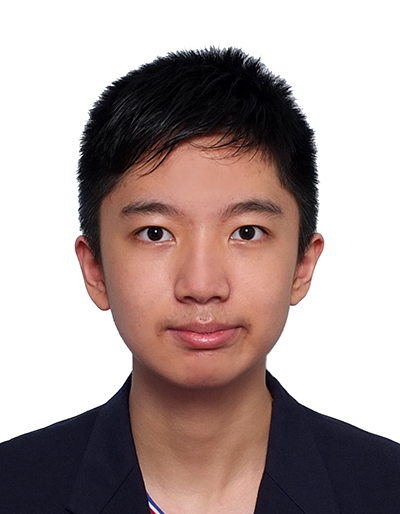
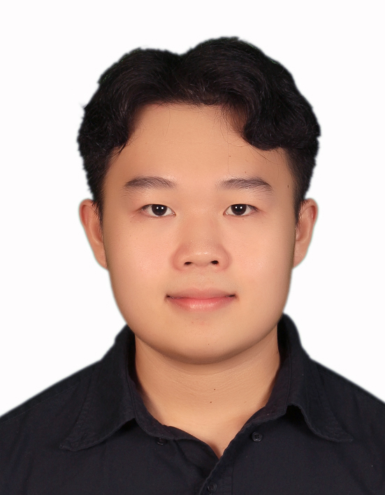

We are a team based in the [School of Computing, National University of Singapore](https://www.comp.nus.edu.sg).

## Project team

### Lim Qi Zao

[[github](https://github.com/zao05)]

* Role: Developer; Documentation (v1.4), Release and deliverables (v1.5), Code quality (v1.6)
* Responsibilities: Develops features across all components in every iteration, with a different main layer each time; leads the duty listed for each iteration.

### Jingyu Shi

[[github](https://github.com/jingyucodes)]

* Role: Developer; Testing (v1.4), Code quality (v1.5), Scheduling and tracking (v1.6)
* Responsibilities: Develops features across all components in every iteration, with a different main layer each time; leads the duty listed for each iteration.

### Khor Kai Shean

[[github](https://github.com/kks070206)]

* Role: Developer; Code quality (v1.4), Scheduling and tracking (v1.5), Testing (v1.6)
* Responsibilities: Develops features across all components in every iteration, with a different main layer each time; leads the duty listed for each iteration.

### Joel Rhys

[[github](https://github.com/Antelyuu)]

* Role: Team lead; Developer; Release and deliverables (v1.4), Testing (v1.5), Documentation (v1.6)
* Responsibilities: Coordinates the overall project; develops features across all components in every iteration, with a different main layer each time; leads the duty listed for each iteration.

### Toh Qi Zhang

[[github](https://github.com/qztoh)]

* Role: Developer; Scheduling and tracking (v1.4), Documentation (v1.5), Release and deliverables (v1.6)
* Responsibilities: Develops features across all components in every iteration, with a different main layer each time; leads the duty listed for each iteration.
