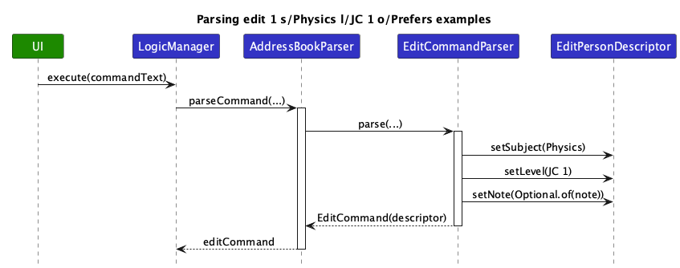
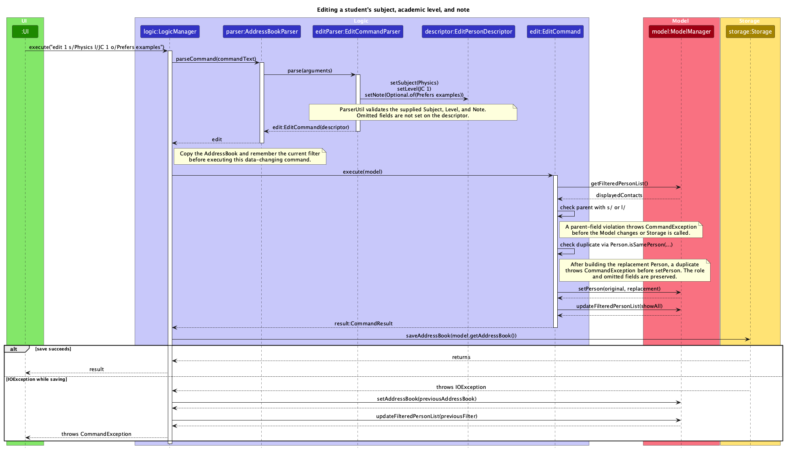
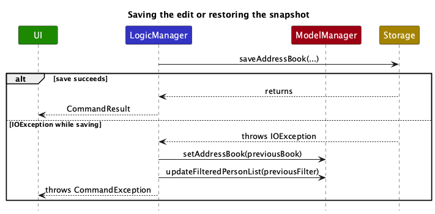
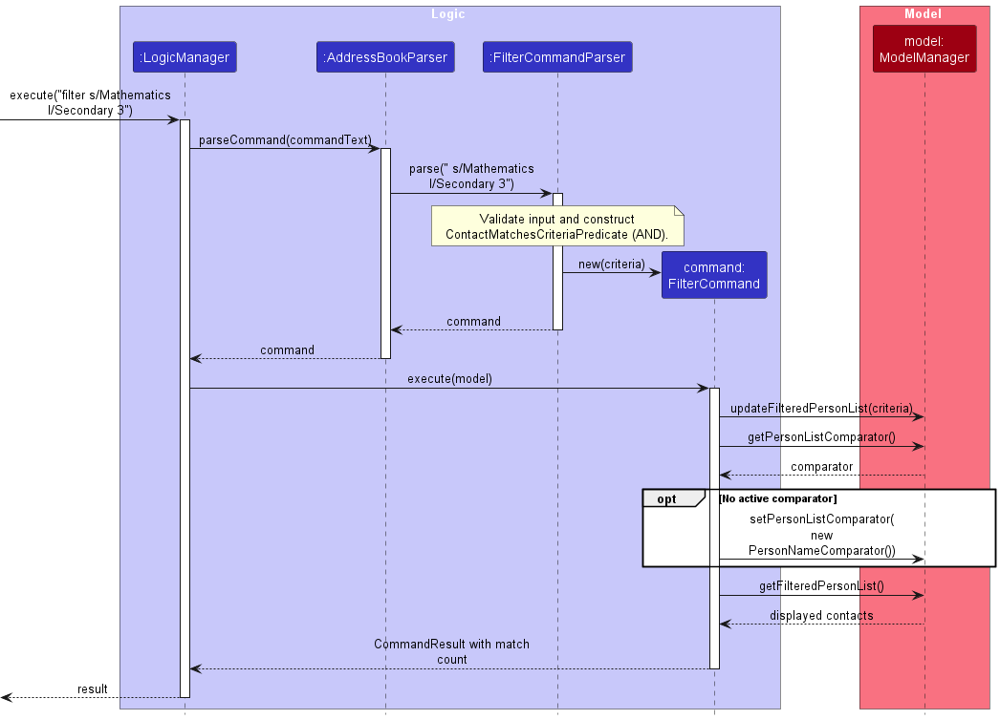
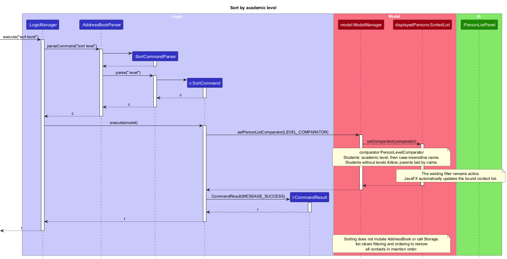
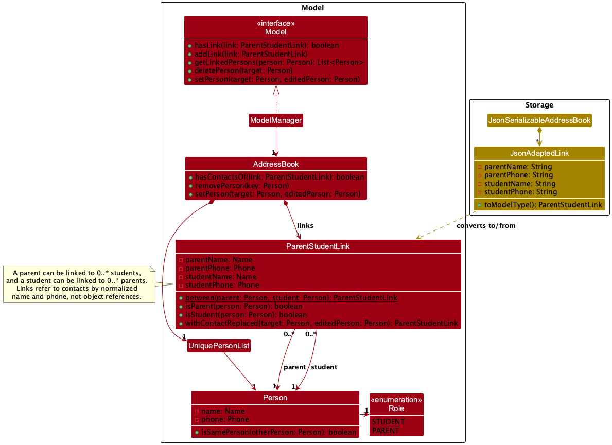

* Table of Contents
{:toc}

--------------------------------------------------------------------------------------------------------------------

## **Acknowledgements**

* TutorContacts is based on the [AddressBook-Level3](https://se-education.org/addressbook-level3/) project created by
  the [SE-EDU initiative](https://se-education.org/), including its code and documentation.
* Third-party libraries used: [JavaFX](https://openjfx.io/), [Jackson](https://github.com/FasterXML/jackson), and
  [JUnit 5](https://github.com/junit-team/junit5).

--------------------------------------------------------------------------------------------------------------------

## **Setting up, getting started**

Refer to the guide [_Setting up and getting started_](SettingUp.md).

--------------------------------------------------------------------------------------------------------------------

## **Design**

<div markdown="span" class="alert alert-primary">

:bulb: **Tip:** The `.puml` files used to create diagrams are in `docs/diagrams`. Refer to the [_PlantUML Tutorial_ at se-edu/guides](https://se-education.org/guides/tutorials/plantUml.html) to learn how to create and edit diagrams.
</div>

### Architecture


The ***Architecture Diagram*** given above explains the high-level design of the App.

The following provides a quick overview of the main components and their interactions.

**Main components of the architecture**

**`Main`** (consisting of classes [`Main`](https://github.com/se-edu/addressbook-level3/tree/master/src/main/java/seedu/address/Main.java) and [`MainApp`](https://github.com/se-edu/addressbook-level3/tree/master/src/main/java/seedu/address/MainApp.java)) is in charge of the app launch and shut down.
* At app launch, it initializes the other components in the correct sequence, and connects them up with each other.
* At shut down, it shuts down the other components and invokes cleanup methods where necessary.

The bulk of the app's work is done by the following four components:

* [**`UI`**](#ui-component): The UI of the App.
* [**`Logic`**](#logic-component): The command executor.
* [**`Model`**](#model-component): Holds the data of the App in memory.
* [**`Storage`**](#storage-component): Reads data from, and writes data to, the hard disk.

[**`Commons`**](#common-classes) represents a collection of classes used by multiple other components.

**How the architecture components interact with each other**

The *Sequence Diagram* below shows how the components interact with each other for the scenario where the user issues the command `delete 1`.


Each of the four main components (also shown in the diagram above),

* defines its *API* in an `interface` with the same name as the Component.
* provides its functionality through a concrete `{Component Name}Manager` class that implements the corresponding API interface.

For example, the `Logic` component defines its API in `Logic.java` and implements it in `LogicManager.java`. Other components interact with a component through its interface rather than its concrete class, preventing them from coupling to that component's implementation, as illustrated in the following partial class diagram.


The sections below give more details of each component.

### UI component

The **API** of this component is specified in [`Ui.java`](https://github.com/se-edu/addressbook-level3/tree/master/src/main/java/seedu/address/ui/Ui.java)


The UI consists of a `MainWindow` and its parts, such as `CommandBox`, `ResultDisplay`, `PersonListPanel`, and `StatusBarFooter`. All of these, including `MainWindow`, inherit from the abstract `UiPart` class, which captures common behavior among classes that represent visible GUI parts.

The `UI` component uses the JavaFX UI framework. The layouts of these UI parts are defined in matching `.fxml` files in `src/main/resources/view`. For example, [`MainWindow.fxml`](https://github.com/se-edu/addressbook-level3/tree/master/src/main/resources/view/MainWindow.fxml) specifies the layout of [`MainWindow`](https://github.com/se-edu/addressbook-level3/tree/master/src/main/java/seedu/address/ui/MainWindow.java).

The `UI` component,

* executes user commands using the `Logic` component.
* listens for changes to `Model` data so that the UI can be updated with the modified data.
* keeps a reference to the `Logic` component, because the `UI` relies on the `Logic` to execute commands.
* depends on some classes in the `Model` component because it displays `Person` objects from the model.

### Logic component

**API** : [`Logic.java`](https://github.com/se-edu/addressbook-level3/tree/master/src/main/java/seedu/address/logic/Logic.java)

Here's a (partial) class diagram of the `Logic` component:


The sequence diagram below shows the successful `execute("delete 1")` path, assuming the displayed list is not empty.


`DeleteCommand` requests the current displayed view with `Model#getFilteredPersonList()`. The note abbreviates
the local lookup `displayedContacts.get(0)`, which resolves displayed index 1 to `contactToDelete`. Filtering and
sorting determine which `Person` occupies that position. The command passes this contact to `Model#deletePerson(Person)`.

For readability, bounds checks, index conversion, collection internals, linked-contact lookup, result construction,
and object lifetime endings are omitted. `r` is the `CommandResult`; its feedback names the deleted contact and
includes the removed-link count when applicable. The data snapshot and Storage save/rollback flow are also omitted:
`LogicManager` saves the changed address book before returning `r`.

How the `Logic` component works:

1. When `Logic` is called upon to execute a command, the command is passed to an `AddressBookParser` object, which in turn creates a parser that matches the command (e.g., `DeleteCommandParser`) and uses it to parse the command.
1. This results in a `Command` object (more precisely, an object of one of its subclasses e.g., `DeleteCommand`) which is executed by the `LogicManager`.
1. The command queries or changes the `Model` when it is executed. For deletion, the displayed index is resolved
   to a contact before the model is changed.
1. The result of the command execution is encapsulated as a `CommandResult` object which is returned from `Logic`.

Here are the other classes in `Logic` (omitted from the class diagram above) that are used for parsing a user command:


How the parsing works:
* When called upon to parse a user command, the `AddressBookParser` class creates an `XYZCommandParser` (`XYZ` is a placeholder for the specific command name, e.g., `AddCommandParser`). The parser uses the other classes shown above to parse the user command and create an `XYZCommand` object (e.g., `AddCommand`). The `AddressBookParser` returns that object as a `Command` object.
* All `XYZCommandParser` classes, such as `AddCommandParser` and `DeleteCommandParser`, implement the `Parser` interface so they can be treated similarly where appropriate, for example during testing.

### Model component
**API** : [`Model.java`](https://github.com/se-edu/addressbook-level3/tree/master/src/main/java/seedu/address/model/Model.java)


The `Model` component,

* stores the address book data i.e., all `Person` objects (which are contained in a `UniquePersonList` object),
  and the `ParentStudentLink` objects that connect parent contacts to student contacts.
* selects contacts through a `FilteredList<Person>` and orders those results through a `SortedList<Person>`.
  `getFilteredPersonList()` exposes the final displayed view as an unmodifiable `ObservableList<Person>`.
  The UI and indexed commands use this same view, so their indices agree.
* stores a `UserPrefs` object that represents the user’s preferences (currently, just the GUI settings). This is exposed to the outside as a `ReadOnlyUserPrefs` object.
* does not depend on any of the other three components (as the `Model` represents data entities of the domain, they should make sense on their own without depending on other components)

<div markdown="span" class="alert alert-info">:information_source: **Note:** The alternative, arguably more object-oriented, design below keeps a unique list of tags in `AddressBook`, and each `Person` references tags from that list. This lets `AddressBook` maintain one `Tag` object per unique tag instead of each `Person` holding its own `Tag` objects.<br>


</div>


### Storage component

**API** : [`Storage.java`](https://github.com/se-edu/addressbook-level3/tree/master/src/main/java/seedu/address/storage/Storage.java)


The `Storage` component,
* can save both address book data and user preference data in JSON format, and read them back into corresponding objects.
* is implemented by `StorageManager`, which delegates the actual JSON file access to `JsonAddressBookStorage` and `JsonUserPrefsStorage` (one class per data file).
* depends on some classes in the `Model` component (because the `Storage` component's job is to save/retrieve objects that belong to the `Model`)

### Common classes

Classes used by multiple components are in the `seedu.address.commons` package.

--------------------------------------------------------------------------------------------------------------------

## **Implementation**

This section describes some noteworthy details on how certain features are implemented.

### Role-specific contact editing

`edit INDEX` updates a contact chosen from the currently displayed list. It retains the contact's role and any
omitted fields. The v1.4 extension adds `s/SUBJECT`, `l/LEVEL`, and `o/NOTE` to the existing edit grammar. Subject
and level can be changed independently on student contacts, while either role can have its note changed. An empty
`o/` explicitly clears the note; a missing `o/` preserves it. Legacy student records lacking subject or level can
still be edited without supplying those fields.

The following three smaller sequence diagrams follow `edit 1 s/Physics l/JC 1 o/Prefers examples`. Splitting the
parsing, model update, and save phases keeps their labels readable at the guide's normal width.

**Parsing:** `AddressBookParser` delegates to `EditCommandParser`, which validates the index syntax, repeated
prefixes, and each supplied value before setting the `EditPersonDescriptor` fields. The descriptor keeps an omitted
note distinct from a specified empty note, so `EditCommand` can preserve or clear the stored value correctly.



**Model update:** `LogicManager` snapshots the `AddressBook` and current filter before executing the command.
`EditCommand#execute` resolves the target in `ModelManager#getFilteredPersonList`, rejects subject or level edits on
a parent, builds a replacement `Person`, and checks the existing duplicate rule before calling
`ModelManager#setPerson`. It then restores the full displayed list and returns a `CommandResult`. The role itself is
never changed.



**Save or rollback:** Only after successful command execution does `LogicManager` call `Storage#saveAddressBook`.
The `alt` fragment shows the save outcome: on an `IOException`, `LogicManager` restores the snapshot and filter,
then reports a `CommandException` instead of returning the successful result.



Other failures are omitted from the diagrams to keep them focused. An invalid index or field value, a repeated or
unknown prefix, an invalid parent-field combination, or a duplicate aborts before `setPerson`, so no data is mutated
or saved. Storage already serializes subject, level, and note, so this extension does not change the JSON format.
### Help command and command guide

`HelpCommand` is read-only: it returns a `CommandResult` with `isShowHelp()` set to `true`.
`LogicManager` returns that result without saving contact data. `MainWindow` then calls `handleHelp()`:
it shows its existing `HelpWindow` if closed, or focuses that same window if already open.

The overview below traces a successful typed `help` command. Its `ref` frames expand into the two focused
diagrams that follow, keeping each diagram readable at the guide's normal page width.


**Help execution** (`HelpCommandExecutionSequenceDiagram.puml`). `AddressBookParser` creates the command;
the command creates result `r`. Constructor details and the routine read-only checks are omitted.
The command returns without contact mutation or a Storage call.


**Help window handling** (`HelpWindowSequenceDiagram.puml`). This expands the UI portion of the overview after
`Logic.execute("help")` returns. It shows the `isShowHelp()` check and the mutually exclusive show/focus paths.
The activation of `executeCommand` includes earlier interactions shown separately in the overview and execution
diagram. Result-display updates, logging, and clipboard operations are omitted from all three diagrams.


The Help menu and the F1 accelerator call `MainWindow#handleHelp()` directly, so they share the same
show-or-focus behavior without parsing a command.

`HelpWindow.fxml` contains the command reference. Its scroll pane fits the available width, and command labels
wrap to keep long formats readable. The resizable window starts within the primary screen's visual bounds,
including display scaling. Its User Guide URL and copy button remain outside the scrolling command list.
When a command's syntax changes, update the reference alongside the User Guide.

### Focused contact filtering

`filter [n/KEYWORDS] [s/SUBJECT] [l/LEVEL]` requires at least one criterion.
`FilterCommandParser` reuses `ArgumentTokenizer`, duplicate-prefix validation, and `ParserUtil`'s subject/level
validation. It rejects unknown prefixes, duplicate prefixes, invalid structure, and invalid values in that order.
Field checks use name, subject, then level order. Parsing finishes before any model state changes.

`ContactMatchesCriteriaPredicate` combines every criterion and every name keyword using **AND**.
Name matching reuses `StringUtil.containsWordIgnoreCase`, the same complete-word comparison used by `find`.
The existing `find` command retains OR between keywords. Subject and level are normalized by their existing value
classes and compared as complete values ignoring case. Missing fields cannot satisfy their respective criteria.

`FilterCommand` replaces the active predicate using `ModelManager#updateFilteredPersonList`. If no comparator is
active, it installs `PersonNameComparator`, which compares complete names ignoring case. `SortedList` retains
source order for comparator ties, so equal names remain in insertion order. An active comparator is preserved.
The predicate and comparator change only the view; `AddressBook` and JSON retain insertion order.
The command reports its displayed count and returns `false` from `isDataChanging()`, so `LogicManager` does not
call Storage.

The following sequence shows the main Logic flow for a successful combined filter, including default ordering
when no comparator is active. Parser construction, individual predicate evaluations, and routine command checks
are omitted for clarity. JavaFX observes the resulting list changes. The existing `MainWindow`/`PersonListPanel`
command handling retains visible selection and expansion or clears a hidden selection.



#### Shared filtering and sorting API

The pipeline is `AddressBook.getPersonList()` → `FilteredList<Person>` → `SortedList<Person>` → `PersonListPanel`.
The displayed observable list object remains the same when its predicate or comparator changes.

| API | Contract |
| --- | --- |
| `getFilteredPersonList()` | Returns the final filtered and ordered view used by the UI and `view`, `edit`, and `delete`. |
| `updateFilteredPersonList(predicate)` | Changes membership without changing the active comparator. |
| `getPersonListComparator()` | Returns the active comparator, or `null` for insertion order. |
| `setPersonListComparator(comparator)` | Changes ordering without changing membership; `null` restores insertion order. |

`list` installs `PREDICATE_SHOW_ALL_PERSONS` and clears the comparator. Existing `find` changes only the predicate.
Successful `add` and `edit` retain their existing filter-clearing behavior and preserve active ordering.
Save-failure rollback restores the previous contacts and predicate; the display comparator remains active.
Filtering and ordering are session state and are not serialized.

**Sorting integration:** `sort level` calls `setPersonListComparator` with its level/name comparator and leaves
the predicate intact. Subsequent `filter` calls preserve that comparator. `list` clears both states.

#### Tests and manual checks

JUnit covers all seven nonempty criterion combinations, AND name matching, exact values, missing fields, duplicate
and unknown prefixes, validation precedence, subject length and academic-level boundaries, no matches, name-order ties,
comparator composition, displayed indices, insertion-order restoration, unchanged JSON, and save-failure rollback.
`ContactListStateTest` covers selection and expansion after filtering and invalid input.

For a manual JavaFX check, use a disposable data folder with contacts inserted in this order:
Zoe Tan (Mathematics, Secondary 3), Alice Tan (parent), Amy Tan (Mathematics, Secondary 3),
Bob Lee (Physics, JC 2). Give the contacts distinct valid contact details.

1. Run `filter s/Mathematics l/Secondary 3`: expect Amy then Zoe and `Showing 2 matching contacts.`
2. Run `view 2`, then repeat that filter: Zoe stays selected and expanded at index 2.
3. Run `filter n/Amy Tan`: expect only Amy; Zoe's selection and expansion clear.
4. Run `view 1`, then `filter s/`: expect the subject error with Amy's selection, expansion, and list unchanged.
5. Run `filter n/Amy Lee`: expect `No matching contacts.`; `find Amy Lee` should return Amy and Bob.
6. Run `filter s/Mathematics`, then `delete 1`: Amy is deleted and Zoe becomes index 1. `view 1` shows Zoe.
7. Run `list`: expect Zoe, Alice, Bob in insertion order with compact cards.
8. Restart: the remaining contacts still follow insertion order. Filtering alone must not rewrite JSON.

### Sort by academic level

`sort level` orders the currently displayed contacts without changing their details or stored order.
`AddressBookParser` creates a `SortCommandParser`, which accepts only `level`, ignoring case and surrounding
Java whitespace, as defined by `Character.isWhitespace`. Missing, unsupported, or extra arguments produce
`Invalid command format. Expected: sort level`
before any model state changes. Successful execution returns `Contacts sorted by academic level.`, even for
an empty list.

The following sequence diagram shows successful parsing and application of the display comparator.



`SortCommand#execute(model)` calls `Model#setPersonListComparator(LEVEL_COMPARATOR)`.
`ModelManager` applies this comparator to its persistent `displayedPersons:SortedList<Person>`, which wraps
`filteredPersons:FilteredList<Person>` over `AddressBook.getPersonList()`. Changing the comparator preserves
the active predicate and does not reorder the source collection. `SortCommand#isDataChanging()` returns `false`,
so `LogicManager` takes its read-only execution branch without a Storage call.

`Level` uses one ordered list for validation, canonical spelling, and the rank returned by `getSortRank()`:
`Primary 1`–`Primary 6`, `Secondary 1`–`Secondary 5`, and `JC 1`–`JC 2`.
`PersonLevelComparator` orders students by rank, then case-insensitive name; parents follow by name.
Legacy students without a level follow other students and precede parents. Equal sort keys compare equal.
`add`, `edit`, and `filter` reuse this validation through `ParserUtil#parseLevel(...)`; JSON loading validates recorded
levels with the same `Level` rules. Unsupported values such as `JC 5` and `Secondary 6` are rejected.
`edit` accepts level changes for students and preserves the existing level when `l/` is omitted.

`getFilteredPersonList()` returns the same displayed view to the UI and to `view`, `edit`, and `delete`, so
their indices follow the displayed order. `PersonListPanel` supplies this observable view to its `ListView`
using `setItems(...)`; JavaFX observes subsequent list changes automatically. After command execution,
`PersonListPanel#completeCommand(...)` restores selection and expansion for any contact still visible and
refreshes the cards. The diagram note summarizes the automatic update without implying a direct method call
from `SortedList` to `PersonListPanel`.

Sorting stays active when `find` or `filter` replaces the predicate; successful `add` and `edit` clear filtering
but retain the comparator. `list` sets `PREDICATE_SHOW_ALL_PERSONS` and clears the comparator with
`setPersonListComparator(null)`, restoring all remaining contacts in insertion order and collapsing details.
The filter and comparator are session state: neither is saved, and restarting restores insertion order.

The diagram shows creation of the command parser, command, and result, with synchronous calls and dashed returns.
Existing model and list objects are created before this scenario. Routine read-only checks in `LogicManager`,
invalid-input paths, validation helpers, object lifetime endings, and JavaFX notification and rendering internals
are omitted to keep the diagram focused on parsing and applying the sort.

### Parent-student links

`link PARENT_INDEX STUDENT_INDEX` records that a parent contact is the parent of a student contact.
Expanded contact cards then list the contact's linked students or parents.

The class diagram below shows how a link is represented and persisted. Fields and classes unrelated to links,
such as `Email`, `Address`, `Tag`, `UserPrefs`, and the storage managers, are omitted.



**Representation.** `AddressBook` keeps a list of `ParentStudentLink` objects beside its `UniquePersonList`.
Each link identifies its parent and its student by `Name` and `Phone`, compared in the same normalized way as the
duplicate-contact rules (`Name#isSameName` and `Phone#isSamePhone`). `ParentStudentLink#isParent` and `#isStudent`
also check the contact's `Role`, because a parent and a student may share a name and phone. Within one role, name
and phone identify at most one contact, so each link resolves to exactly one parent and one student.
A parent can have 0..* linked students and a student can have 0..* linked parents.
Cards and `link` messages show each linked contact as `Name (phone)`, because two contacts may share a name.

**Normal path.** `LinkCommandParser` parses two displayed-list indices. `LinkCommand#execute` looks up both
contacts in `Model#getFilteredPersonList()`, checks that the first is a parent and the second a student, creates the
link with `ParentStudentLink#between`, and rejects a duplicate using `Model#hasLink`. It then calls
`Model#addLink` and returns a result that expands the parent's card. `LogicManager` saves the address book because
the command changes data. `PersonListPanel` asks `Logic#getLinkedPersons` for each card's linked contacts.

**Keeping links consistent.** `AddressBook` updates links whenever contacts change, so every command that changes
contacts keeps links valid without extra code:

* `removePerson` removes every link that involves the deleted contact. `DeleteCommand` reports how many it removed.
* `setPerson` calls `ParentStudentLink#withContactReplaced`, which rewrites the side of a link that matched the
  edited contact. Editing a name or phone therefore keeps the link.
* `resetData` copies links, so `clear` and the save-failure rollback restore links together with contacts.

**Storage.** `JsonSerializableAddressBook` saves links in a `links` list of `JsonAdaptedLink` objects, each holding the
two names and phones as strings. When loading, it rejects a link with invalid fields, a link whose parent or student
is not in the `persons` list, and a duplicate link, so a corrupted file is reported instead of loading broken links.
A file without a `links` list loads with no links, so data files from earlier versions remain valid.

**Design considerations.**

* **Alternative 1 (current choice):** store links in `AddressBook`, identified by name and phone.
  * Pros: `Person` and its equality are unchanged, deleting and editing update links in one place, and the data file
    stays readable and editable by hand.
  * Cons: a link must be rewritten when a linked contact's name or phone changes.
* **Alternative 2:** store a list of linked students inside each parent `Person`.
  * Pros: a card can read links straight from its contact.
  * Cons: every `Person` copy (for example in `edit`) must carry the links, and deleting a student must update every
    parent object.
* **Alternative 3:** give each `Person` a generated ID and link by ID.
  * Pros: links survive any edit without rewriting.
  * Cons: IDs must be generated, saved, and validated, which adds risk to every existing command and data file.

### \[Proposed\] Undo/redo feature

#### Proposed Implementation

The proposed undo/redo mechanism is facilitated by `VersionedAddressBook`. It extends `AddressBook` with an undo/redo history, stored internally as an `addressBookStateList` and `currentStatePointer`. Additionally, it implements the following operations:

* `VersionedAddressBook#commit()` — Saves the current address book state in its history.
* `VersionedAddressBook#undo()` — Restores the previous address book state from its history.
* `VersionedAddressBook#redo()` — Restores a previously undone address book state from its history.

These operations are exposed in the `Model` interface as `Model#commitAddressBook()`, `Model#undoAddressBook()` and `Model#redoAddressBook()` respectively.

Given below is an example usage scenario and how the undo/redo mechanism behaves at each step.

Step 1. The user launches the application for the first time. The `VersionedAddressBook` will be initialized with the initial address book state, and the `currentStatePointer` pointing to that single address book state.


Step 2. The user executes `delete 5` command to delete the 5th person in the address book. The `delete` command calls `Model#commitAddressBook()`, causing the modified state of the address book after the `delete 5` command executes to be saved in the `addressBookStateList`, and the `currentStatePointer` is shifted to the newly inserted address book state.


Step 3. The user executes `add n/David …​` to add a new person. The `add` command also calls `Model#commitAddressBook()`, causing another modified address book state to be saved into the `addressBookStateList`.


<div markdown="span" class="alert alert-info">:information_source: **Note:** If a command fails its execution, it will not call `Model#commitAddressBook()`, so the address book state will not be saved into the `addressBookStateList`.

</div>

Step 4. The user now decides that adding the person was a mistake, and decides to undo that action by executing the `undo` command. The `undo` command will call `Model#undoAddressBook()`, which will shift the `currentStatePointer` once to the left, pointing it to the previous address book state, and restores the address book to that state.


<div markdown="span" class="alert alert-info">:information_source: **Note:** If the `currentStatePointer` is at index 0, pointing to the initial AddressBook state, then there are no previous AddressBook states to restore. The `undo` command uses `Model#canUndoAddressBook()` to check if this is the case. If so, it will return an error to the user rather
than attempting to perform the undo.

</div>

The following sequence diagram shows how an undo operation goes through the `Logic` component:


<div markdown="span" class="alert alert-info">:information_source: **Note:** The lifeline for `UndoCommand` should end at the destroy marker (X), but due to a limitation of PlantUML, it continues to the end of the diagram.

</div>

Similarly, how an undo operation goes through the `Model` component is shown below:


The `redo` command does the opposite — it calls `Model#redoAddressBook()`, which shifts the `currentStatePointer` once to the right, pointing to the previously undone state, and restores the address book to that state.

<div markdown="span" class="alert alert-info">:information_source: **Note:** If the `currentStatePointer` is at index `addressBookStateList.size() - 1`, pointing to the latest address book state, then there are no undone AddressBook states to restore. The `redo` command uses `Model#canRedoAddressBook()` to check if this is the case. If so, it will return an error to the user rather than attempting to perform the redo.

</div>

Step 5. The user then decides to execute the command `list`. Commands that do not modify the address book, such as `list`, will usually not call `Model#commitAddressBook()`, `Model#undoAddressBook()` or `Model#redoAddressBook()`. Thus, the `addressBookStateList` remains unchanged.


Step 6. The user executes `clear`, which calls `Model#commitAddressBook()`. Since the `currentStatePointer` is not pointing at the end of the `addressBookStateList`, all address book states after the `currentStatePointer` will be purged. Reason: It no longer makes sense to redo the `add n/David …​` command. This is the behavior that most modern desktop applications follow.


The following activity diagram summarizes what happens when a user executes a new command:


#### Design considerations:

**Aspect: How undo & redo execute:**

* **Alternative 1 (current choice):** Saves the entire address book.
  * Pros: Easy to implement.
  * Cons: May have performance issues in terms of memory usage.

* **Alternative 2:** Individual command knows how to undo/redo by
  itself.
  * Pros: Will use less memory (e.g. for `delete`, just save the person being deleted).
  * Cons: We must ensure that the implementation of each individual command is correct.

_{more aspects and alternatives to be added}_

### \[Proposed\] Data archiving

_{Explain here how the data archiving feature will be implemented}_


--------------------------------------------------------------------------------------------------------------------

## **Documentation, logging, testing, dev-ops**

* [Documentation guide](Documentation.md)
* [Testing guide](Testing.md)
* [Logging guide](Logging.md)
* [DevOps guide](DevOps.md)

--------------------------------------------------------------------------------------------------------------------

## **Appendix: Requirements**

### Product scope

**Target user profile**: An independent private tutor who manages approximately 15–30 students and their parents,
works alone, and prefers typing commands to navigating menus. The tutor needs to retrieve contact and tutoring
information while preparing lessons or communicating with parents.

**Value proposition**: TutorContacts keeps student and parent contact information, together with essential tutoring
details, in one place. Typed commands let the tutor record contacts and retrieve the information needed for lesson
preparation or parent communication. The initial MVP focuses on creating, viewing, deleting, and retaining contact
records. Version 1.4 adds parent-student links so the tutor can see which parents belong to which students.

### User stories

Priority describes the importance of a user need, not whether the feature has already been implemented.

Priorities:
* High (must-have for the agreed MVP) - `* * *`;
* Medium (post-MVP enhancement) - `* *`.

| Priority | As a… | I can… | So that I can… |
| --- | --- | --- | --- |
| `* * *` | private tutor | add a student contact | keep the student's contact information in one place |
| `* * *` | private tutor | add a parent contact | keep the information needed to contact that parent |
| `* * *` | private tutor | record one subject for a student | remember which subject I teach that student |
| `* * *` | private tutor | record a student's academic level | prepare teaching materials appropriate for that student |
| `* * *` | private tutor | add a short note to a contact | remember relevant details such as a lesson preference |
| `* * *` | private tutor | list all my contacts | see my student and parent records at a glance |
| `* * *` | private tutor | view a contact's complete details | read information that is not shown in the contact list |
| `* * *` | private tutor | delete an unwanted contact | remove an incorrect or no longer needed record |
| `* * *` | private tutor | retrieve my contact records after reopening TutorContacts | continue using records entered in an earlier session |
| `* * *` | private tutor | exit TutorContacts safely | end a session without losing an accepted contact change |
| `* *` | private tutor | edit a contact's details | keep the record accurate when details change |
| `* *` | private tutor | find contacts by name | locate someone without scanning the complete list |
| `* *` | private tutor | link a parent to one or more students | identify whom to contact for each student without duplicating the parent's record |
| `* *` | private tutor | archive an inactive contact | keep its information without showing it among active contacts |
| `* *` | new TutorContacts user | see a brief command guide | learn the available commands without reading the full user guide |
| `* *` | private tutor | record multiple subjects for a student | keep all subjects I teach that student in one record |
| `* *` | private tutor | filter students by subject | review contacts relevant to a particular subject |
| `* *` | private tutor | filter students by academic level | review students at a particular level |
| `* *` | private tutor | sort students by academic level | review students at similar levels together |
| `* *` | private tutor | assign custom tags to contacts | group contacts according to my teaching needs |

### Use cases

(For all use cases below, the **System** is `TutorContacts` and the **Actor** is the tutor, unless specified
otherwise. `INDEX` is the one-based position in the displayed contact list. The original MVP use cases follow the
[V2 TutorContacts MVP specification](https://docs.google.com/document/d/13atDT_z6unnRSmTLVOimhPvUcavvWek9Xy9jy5YNyFY/edit?tab=t.pgg9f79ckkj4);
the edit use case describes the subsequent v1.4 extension.
Failed commands leave the displayed and saved contact data unchanged. Some specified behavior is not yet implemented
in the current AB3 codebase.)

**Use case: Add a student or parent contact**

**MSS**

1. User enters `add` with a role, name, phone, email, and address. The user supplies a subject and level for a student
   and may supply a note for either role.
2. TutorContacts validates the fields and checks for a duplicate contact.
3. TutorContacts adds the contact to the end of the list and selects its compact card, which shows its index, role,
   name, and phone.
4. TutorContacts saves the updated data file and reports `Added student: NAME.` or `Added parent: NAME.`

   Use case ends.

**Extensions**

* 2a. A general required field is missing, a value is invalid, or a prefix is unknown or repeated.
  * 2a1. TutorContacts shows the applicable format, validation, or prefix error. No contact is added.

    Use case resumes at step 1.
* 2b. A student is missing a subject or level, or a parent has either field.
  * 2b1. TutorContacts shows the role-specific error. No contact is added.

    Use case resumes at step 1.
* 2c. A contact has the same role and normalized name as an existing contact, and its normalized phone or email also
  matches.
  * 2c1. TutorContacts shows `This contact duplicates an existing ROLE: NAME.` No contact is added.

    Use case resumes at step 1.
* 4a. TutorContacts cannot save the data file.
  * 4a1. TutorContacts shows `Contact was not added because TutorContacts could not save the data file.` The contact is
    not added, and the displayed and saved data remain unchanged.

    Use case ends.

**Use case: List all contacts**

**MSS**

1. User enters `list` to see all contacts.
2. TutorContacts shows every contact in insertion order, numbered from 1, with its role, name, and phone on a compact
   card. Any expanded contact card is collapsed.
3. TutorContacts reports `Showing N contacts.`
4. User scans the list. No contact data is changed or saved.

   Use case ends.

**Extensions**

* 1a. User supplies extra text or parameters after `list`.
  * 1a1. TutorContacts shows `Invalid command format. Expected: list` and leaves the displayed list unchanged.

    Use case ends.
* 2a. There are no contacts.
  * 2a1. TutorContacts shows an empty list and reports `No contacts to display.`

    Use case ends.

**Use case: View one contact's complete details**

**MSS**

1. User enters `list` to display contacts.
2. TutorContacts displays contacts with their current index numbers.
3. User enters `view INDEX` for a contact in that displayed list.
4. TutorContacts highlights and expands the indexed contact card in place. The other cards remain compact, and the
   list remains visible.
5. TutorContacts shows the contact's role, name, phone, email, address, note, and subject and level if it is a student.
   TutorContacts reports `Showing contact: NAME.` No contact data is changed or saved.

   Use case ends.

**Extensions**

* 3a. The index is non-numeric, zero, or negative.
  * 3a1. TutorContacts shows `Index must be a positive integer shown in the current list.` The displayed list and
    expanded-card selection remain unchanged.

    Use case resumes at step 3.
* 3b. The index is larger than the currently displayed list.
  * 3b1. TutorContacts shows `No contact exists at index INDEX in the current list.` The displayed list and
    expanded-card selection remain unchanged.

    Use case resumes at step 3.
* 3c. The index is missing, or the user supplies extra arguments.
  * 3c1. TutorContacts shows `Invalid command format. Expected: view INDEX` and leaves the displayed list and
    selection unchanged.

    Use case resumes at step 3.

**Use case: Delete a contact**

**MSS**

1. User enters `list` to display contacts.
2. TutorContacts displays the contacts with their current index numbers.
3. User enters `delete INDEX` for a contact in that displayed list.
4. TutorContacts removes the contact card, refreshes and renumbers the list, and clears the selection if the deleted
   contact was selected.
5. TutorContacts saves the updated data file and reports `Deleted contact: ROLE NAME (PHONE).`

   Use case ends.

**Extensions**

* 3a. The index is non-numeric, zero, or negative.
  * 3a1. TutorContacts shows `Index must be a positive integer shown in the current list.` Nothing is deleted.

    Use case resumes at step 3.
* 3b. The index is larger than the currently displayed list.
  * 3b1. TutorContacts shows `No contact exists at index INDEX in the current list.` Nothing is deleted.

    Use case resumes at step 3.
* 3c. The index is missing, or the user supplies extra arguments.
  * 3c1. TutorContacts shows `Invalid command format. Expected: delete INDEX`. Nothing is deleted.

    Use case resumes at step 3.
* 5a. TutorContacts cannot save the data file.
  * 5a1. TutorContacts shows `Contact was not deleted because TutorContacts could not save the data file.` The contact
    remains, and the displayed and saved data remain unchanged.

    Use case ends.

**Use case: Edit a student or parent contact**

**MSS**

1. The tutor enters `edit INDEX` with at least one field to change. For a student, this may include subject and
   academic level; either role may have a note.
2. TutorContacts resolves `INDEX` in the currently displayed list, validates the supplied fields against the
   contact's role, and checks that the edited contact does not duplicate another record.
3. TutorContacts replaces the contact while retaining its role and omitted fields, then shows the complete list.
4. TutorContacts saves the updated data and reports `Edited person: ...`.

   Use case ends.

**Extensions**

* 1a. The index is invalid, no field is supplied, or a prefix or value is invalid.
  * 1a1. TutorContacts reports the relevant error. No contact data is changed.

    Use case resumes at step 1.
* 2a. The tutor supplies `s/` or `l/` for a parent contact.
  * 2a1. TutorContacts reports `Subject and level are only valid for student contacts.` No contact data is changed.

    Use case resumes at step 1.
* 2b. The replacement contact would duplicate another contact under the existing role, name, phone, and email rule.
  * 2b1. TutorContacts reports `This person already exists in the address book.` No contact data is changed.

    Use case resumes at step 1.
* 4a. TutorContacts cannot save the data file.
  * 4a1. TutorContacts restores the previous contact data and displayed filter, then reports a storage error. The
    existing data file remains unchanged.

    Use case ends.

**Use case: Save data and exit safely**

**MSS**

1. User adds, edits, or deletes a contact.
2. TutorContacts saves the contacts and their role-specific fields to `data/tutorcontacts.json` before confirming the
   command.
3. User enters `exit`.
4. TutorContacts reports `Exiting TutorContacts.` and closes after confirming that no accepted change remains unsaved.
5. User launches TutorContacts again.
6. TutorContacts loads every saved contact field and displays the restored compact-card list.

   Use case ends.

**Extensions**

* 2a. TutorContacts cannot save the data file.
  * 2a1. TutorContacts reports the relevant save-failure message. The displayed and saved data remain
    unchanged.

    Use case ends.
* 3a. User supplies extra text after `exit`.
  * 3a1. TutorContacts shows `Invalid command format. Expected: exit` and remains open.

    Use case resumes at step 3.
* 6a. The data file is missing.
  * 6a1. TutorContacts starts with an empty list without an error. It creates the file on the first successful
    data-changing command.

    Use case ends.
* 6b. The data file is unreadable or structurally invalid, including an invalid or duplicate contact record.
  * 6b1. TutorContacts starts with an empty list and shows
    `Warning: TutorContacts could not load data/tutorcontacts.json. The existing file was not changed.`
  * 6b2. TutorContacts leaves the existing file unchanged.

    Use case ends.

### Non-Functional Requirements

**Platform and distribution**

1.  Should work on any _mainstream OS_ with Java `25` installed, without requiring any other Java version.
2.  Should run from a single JAR file without an installer.
3.  The JAR file should not exceed 100 MB.

**Performance**

4.  Should hold up to 1000 contacts without noticeable sluggishness for typical usage. This is well above the
    expected 15–30 students and their parents.
5.  Should respond to any command within 2 seconds on a typical laptop when holding up to 1000 contacts.

**Usability**

6.  A user with above-average typing speed for regular English text (i.e. not code, not system admin commands)
    should be able to accomplish most tasks faster using commands than using the mouse.
7.  The GUI should work well (i.e. no resolution-related inconveniences) at screen resolutions of 1920x1080 and
    higher with screen scales of 100% and 125%, and remain usable at resolutions of 1280x720 and higher with a
    screen scale of 150%.

**Data and reliability**

8.  Should store all data locally in a human-editable _data file_, without using a database management system.
9.  Should not lose any change that TutorContacts has confirmed, even if the application is closed immediately
    afterwards.
10. Should leave a data file that it cannot load unchanged at startup, so that the user can inspect or repair it.

**Scope and privacy**

11. Should be used by a single user and should not support shared or multi-user access to the data.
12. Should work without an internet connection and should not depend on any remote server.
13. Should not transmit student or parent contact information outside the user's computer.

### Glossary

* **Academic level**: A student's stage of study: `Primary 1`–`Primary 6`, `Secondary 1`–`Secondary 5`,
  or `JC 1`–`JC 2`. Recorded only for student contacts, using canonical capitalization.
* **Compact card**: The summary of a contact shown in the contact list, displaying its index, role, name, and phone.
* **Data file**: The file `data/tutorcontacts.json`, in the same folder as the JAR file, in which TutorContacts saves
  all contacts.
* **Duplicate contact**: A contact with the same role and _normalized name_ as an existing contact, and whose phone
  or email also matches that contact's.
* **Expanded card**: A contact card that shows all of the contact's details after a `view INDEX` command.
* **INDEX**: The one-based position of a contact in the currently displayed contact list.
* **Mainstream OS**: Windows, Linux, Unix, or macOS.
* **MVP**: Minimum viable product; the smallest version of TutorContacts that delivers its core value.
* **Normalized name**: A name after leading and trailing spaces are removed and consecutive internal spaces are
  collapsed into one. Normalized names are compared ignoring case when detecting duplicates, so `Alex  Tan` and
  `alex tan` are the same normalized name.
* **Note**: A short, optional remark on a contact, such as a lesson preference.
* **Parent contact**: A contact with the `parent` role, typically the parent or guardian of a student.
* **Prefix**: A short marker such as `r/` or `n/` that identifies which field a command parameter belongs to.
* **Private tutor**: An independent tutor who works alone, teaching students privately rather than through a school
  or tuition agency.
* **Role**: The type of a contact, either `student` or `parent`, which determines the fields the contact has.
* **Student contact**: A contact with the `student` role. Newly added student contacts require a subject and an
  academic level; legacy records may lack either field.
* **Subject**: The subject that the tutor teaches a student, such as `A-Math`. Recorded only for student contacts.

--------------------------------------------------------------------------------------------------------------------

## **Appendix: Instructions for manual testing**

### Help command guide

Use a disposable data file containing at least two contacts. Before testing, run `view 1` and note the
selected contact, expanded details, and the data file's contents and last-modified time.

1. Enter `help`. Expect one window titled **TutorContacts — Command guide**, containing the command reference
   and the TutorContacts User Guide URL. Enter `help` again in the main window: the same Help window should
   receive focus, without opening a second window.
2. Close Help, then choose **Help → Help** in the main window. Close it again and press **F1** in the main
   window. Each action should reopen the guide. With Help already open, repeat both actions and check that
   no additional Help window appears.
3. Scroll to the end of the command list and back. Expect the `exit` entry to be reachable, while the User
   Guide URL and **Copy User Guide URL** button stay visible outside the scrolling list.
4. Resize Help to its minimum size (450 × 360), then enlarge it. Expect long command formats and the URL
   to wrap without clipping, and the reference to remain scrollable. Repeat at 1920 × 1080 with 100% and
   125% scaling, and at 1280 × 720 with 150% scaling on available supported systems.
5. Select **Copy User Guide URL** and paste into a browser's address bar. Expect exactly
   `https://ay2627s1-cs2103t-t17-1.github.io/tp/UserGuide.html`. With Internet access, navigate to it and
   verify that it opens the TutorContacts User Guide, not the inherited AB3 guide.
6. Close Help. Expect the contact list, selected contact, and expanded details to be unchanged. Check that
   the data file's contents and last-modified time still match the values recorded before opening Help.

### Command parsing and validation

The add parser accepts `r/`, `n/`, `p/`, `e/`, `a/`, `s/`, `l/`, and `o/`. All are single-value prefixes.
Unknown-prefix detection runs before duplicate-prefix detection, followed by base-field presence, role,
role-specific field rules, field-value validation, and model duplicate detection. `Subject`, `Level`, and `Note`
reuse the model/storage foundation; `Person` retains its compatibility constructor for legacy records.
Newly added students must have subject and level, while parents cannot supply either prefix.

Field constructors normalize values and share validation with `ParserUtil` and JSON loading. Names are
compared case-insensitively for duplicate identity; capitalization remains significant for full object equality
and is retained in stored data. `ExitCommandParser` rejects arguments before an exit result can reach the UI.

`Email` uses possessive repetition for the dot-separated domain labels. A label cannot contain a dot, so consumed
labels do not need to be reconsidered. This avoids recursive matcher backtracking for long domains while retaining
the existing email grammar and shared command/JSON validation. No email-length limit is introduced.

`Address` retains `String.trim()` normalization and the 1–150 code-point limit. Its regex requires at least one character
in Unicode category `L`, `N`, `P`, or `S`, and still excludes controls (`Cc`) and line/paragraph separators (`Zl`, `Zp`).
Formatting and combining marks are preserved alongside qualifying content. Values containing only spaces, formatting,
or marks are rejected through both command parsing and JSON loading. This is a category-based policy: the letter
U+3164 and symbol U+2800 satisfy it even when their rendering appears blank. Do not describe the rule as detecting
every visually invisible value. A newly invalid stored address triggers the existing startup warning and write
protection; users repair the preserved file before restarting. No address or contact is silently substituted or dropped.

`AddressBookParser` strips outer command padding with `String.strip()`. `ListCommandParser` uses `isBlank()`, and
`SortCommandParser` strips its criterion before comparing it with `level`. These methods use Java whitespace,
including U+2003 EM SPACE; U+00A0 NON-BREAKING SPACE and U+200B ZERO WIDTH SPACE are not Java whitespace. Prefix
recognition and separators inside commands retain their existing syntax.

`ParserUtil.parseNote` treats empty or Java-whitespace-only input as absent. `Note` strips surrounding Java
whitespace before validating length and content, while preserving internal spacing. `JsonAdaptedPerson` also maps
missing, empty, or Java-whitespace-only stored notes to absence, keeping files saved by earlier versions loadable.
Loading does not rewrite contact data; the next successful data-changing command saves the normalized values.

`MvpCommandIntegrationTest` exercises all five commands, exact feedback, normalized duplicates, preserved
data after rejected input, presentation requests, and JSON round trips. `ParserUtilTest` and field tests cover
limits and invalid values. `ExitCommandParserTest` checks the parameterless exit grammar.

`EditCommandParserTest` covers the new edit prefixes, empty-note clearing, and invalid values. `EditCommandTest`
checks student and parent edits, legacy students, and rejection before mutation. `LogicManagerTest` checks that
edited fields survive a storage round trip and that a failed save restores the previous data and displayed filter.

`InputValidationIntegrationTest` checks long-email add/edit/duplicate handling, Unicode note omission and clearing,
list/sort composition, unchanged state after rejection, and loading legacy blank notes without losing contacts or
links. `ContactCardsUiTest` checks the corresponding command-box feedback, selection, expansion, and JSON behavior
when `RUN_UI_TESTS=true`.

With a disposable data file, manually verify:

1. Add a student with subject, level, a formatted phone, and a note. Run `view 1` and check every stored field.
2. Add a parent without subject or level. Check the parent card omits those fields. An empty `o/` omits its note.
3. Try a student without subject/level, a parent with either prefix, repeated `o/`, an unknown prefix, and a
   field exceeding its length limit. Verify exact errors and unchanged list data, selection, and JSON.
4. Re-add the student's identity with different name/email capitalization or phone separators. Check duplicates
   are rejected. Check a matching name with different phone and email, or a cross-role match, is accepted.
5. Run `list`, `view INDEX`, and `delete INDEX`. Check feedback, insertion order, visible indexes, and selection.
6. Restart and verify all added fields are restored. Check read-only commands do not rewrite the JSON file.
7. Run `exit 3`: the window must remain open. Run `exit`: it should close successfully.

### Email and whitespace validation

Use a disposable writable folder and Java 25 for these command-box checks:

1. Add a parent with a note:

   ```text
   add r/parent n/Alpha Parent p/91000001 e/alpha@example.com a/1 Test Road o/Original note
   ```

2. On Windows, generate a long email command in PowerShell, paste it into TutorContacts, and execute it:

   ```powershell
   $emailProbe = 'a@' + ('a.' * 2500) + 'com'
   Set-Clipboard -Value ('add r/parent n/Email Parent p/91000002 e/' + $emailProbe + ' a/2 Test Road')
   ```

   Expect `Added parent: Email Parent.`, a cleared command box, and two saved contacts. Then copy and execute
   `('edit 1 e/' + $emailProbe + '.')` using `Set-Clipboard -Value`. Expect the email constraint message, error
   styling, and unchanged contacts, selection, expansion, and JSON. The invalid suffix must not cause a stack error.

3. Copy and execute each generated command independently:

   ```powershell
   Set-Clipboard -Value ('edit 1 o/' + [char]0x2003 + ' a/1 Test Road')
   Set-Clipboard -Value ('sort ' + [char]0x2003 + 'LEVEL' + [char]0x2003)
   Set-Clipboard -Value ('list ' + [char]0x2003)
   ```

   After the edit, run `view 1` and expect `Note: None`. Expect the normal sort/list success messages, with no
   additional JSON writes for those read-only commands. Repeat with a nonblank note padded with U+2003 and check
   that only its surrounding whitespace is removed. Verify that `sort level extra` still fails normally.

4. Close the app before manually editing its disposable JSON. Set the parent's note to `"\u2003"` and restart.
   Expect both contacts to load and the parent's note to be absent. Reading the file must not rewrite it. Make a
   valid contact change, restart again, and check that the normalized data and unrelated contact details persist.

### Editing subject, level, and note

Use a disposable data file for these checks:

1. Add a student with `s/Math l/Secondary 3 o/Original note` and a parent with a note. Run
   `edit 1 s/Physics l/JC 1 o/Prefers examples`, then `view 1`. Check the three updated values and unchanged role,
   name, phone, email, and address. Restart and check the same values are restored from JSON.
2. Run `edit 1 s/A-Math`. Check the student's existing level and note remain unchanged. Run `edit 1 o/`, then
   `view 1`; the note should be absent. Update and clear the parent's note in the same way.
3. Try `edit 2 s/Math`, `edit 2 l/JC 1`, empty `s/` and `l/` on the student, a repeated `o/`, and a duplicate
   identity edit. Check the applicable error and that neither the displayed contact nor JSON changes.
4. With a legacy student record lacking subject or level, edit an unrelated field. Check the edit succeeds without
   inventing the missing field. Repeat a valid edit with a failing storage save and check the contact, displayed
   filter, and saved JSON remain as they were before the command.

### Contact-card UI

Prefix recognition checks (use disposable test data):

1. Enter `ADD R/PARENT N/Prefix Parent P/81234567 E/prefix@example.com A/311, Clementi Ave 2, #02-25`.
   Check that capitalization is retained and a parent contact is added, then run `view 1` to expand it.
2. Enter `add n/Alex x/foo`. Expect `Unknown prefix: x/.` with the selected contact and expansion unchanged.
3. Enter `add n/Alex N/Bob`. Expect `Prefix n/ may be specified only once.` with no contact-data change.
4. Enter `add r/parent n/Literal Parent p/91234567 e/literal@example.com a/21 Clementi Ave 3 o/Discuss \x/foo`.
   View the added contact and check its note is `Discuss x/foo`. Check the JSON stores that same literal text.

The prefix and student/parent flow tests in `ContactCardsUiTest` check prefix recognition and literal text
through real command-box execution and JSON storage when `RUN_UI_TESTS=true`.

`CommandResult` carries a `ContactListAction` and an optional target contact. `add` requests selection,
`view` requests selection and expansion, and `list` requests collapse. Other successful commands retain the
selection only while that contact remains visible. `MainWindow` applies these requests after `Logic.execute`
returns, including any required save. `PersonListPanel` ignores transient JavaFX selection changes during
execution and reconciles the final list using `ContactListState`, which retains contacts rather than indices.
Failed commands restore the prior presentation against the final model; restoring model data after a failed save
is the logic layer's responsibility.

`ContactListStateTest` runs in the normal headless JUnit suite. `ContactCardsUiTest` additionally checks actual
FXML fields and command-box integration on a desktop. With Java 25, run it using:

* PowerShell: `$env:RUN_UI_TESTS='true'; .\gradlew.bat test --tests '*ContactCardsUiTest' --rerun-tasks`
* macOS/Linux with a graphical display: `RUN_UI_TESTS=true ./gradlew test --tests '*ContactCardsUiTest' --rerun-tasks`

The desktop tests are opt-in because CI does not provide a graphical display on every platform.
They save rendered previews under `build/reports/ui` for visual inspection.

Manual checks for the UI contribution:

1. Start with at least two contacts. Check that compact cards show only index, role, name, and phone.
2. Run `view 2`, then `view 1`: only the latest target should be expanded. Check student subject/level,
   parent omission of those fields, email, address, and note. Check long names and notes wrap without clipping.
3. Run `view 0`, `view 99` (when out of range), and `view 1 extra`: selection and expansion must not change.
4. Run `list`: all cards should be compact. Add a contact: its compact card should be selected and visible.
5. View the second contact and delete the first: the same contact should stay expanded with index 1.
   Delete that selected contact: selection should clear. Repeat within filtered search results.
6. Check resizing and scrolling at 1920x1080 with 100%/125% scaling and 1280x720 with 150% scaling.
   Keyboard command entry must remain usable after selection changes.
7. Repeat add, edit, and delete with a failing save and check both the list data and selection remain unchanged.
   UI tests simulate model restoration; they do not verify storage rollback.

Given below are instructions to test the app manually.

<div markdown="span" class="alert alert-info">:information_source: **Note:** These instructions only provide a starting point for testers to work on;
testers are expected to do more *exploratory* testing.

</div>

### Linking a parent to a student

1. Prerequisites: close TutorContacts, then move `data/tutorcontacts.json` (next to the JAR file) elsewhere so that
   the app starts with an empty list. Start TutorContacts and enter these commands in order. The two students share
   a name, so the steps also check that linked contacts can be told apart.
   1. `add r/student n/Alex Tan p/91234567 e/alex@example.com a/1 Road s/Mathematics l/Secondary 3`
   1. `add r/student n/Alex Tan p/98765432 e/alex.lim@example.com a/2 Road s/English l/Primary 6`
   1. `add r/parent n/Mary Tan p/93334444 e/mary@example.com a/1 Road`
   1. `list`

   Expected: index 1 is Alex Tan (91234567), index 2 is Alex Tan (98765432), and index 3 is Mary Tan.
1. Test case: `link 3 1`<br>
   Expected: `Linked parent Mary Tan (93334444) to student Alex Tan (91234567).` Mary Tan's card expands and shows
   `Linked students: Alex Tan (91234567)`.
1. Test case: `link 3 2`<br>
   Expected: Mary Tan's card shows `Linked students: Alex Tan (91234567), Alex Tan (98765432)`.
1. Test case: `link 3 1`, then `link 1 2`, then `link 3 3`<br>
   Expected: in turn, `Mary Tan (93334444) is already linked to Alex Tan (91234567).`,
   `The contact at index 1 is not a parent.`, and `A contact cannot be linked to itself.` No data changes.
1. Test case: `edit 1 p/80000000`, then `view 1`<br>
   Expected: the first Alex Tan shows `Linked parents: Mary Tan (93334444)`. `view 3` shows
   `Linked students: Alex Tan (80000000), Alex Tan (98765432)`.
1. Test case: close and reopen TutorContacts, then `view 3`<br>
   Expected: Mary Tan still shows both linked students.
1. Test case: `delete 1`<br>
   Expected: `Deleted contact: student Alex Tan (80000000). Removed 1 link(s).` `view 2` shows only
   `Alex Tan (98765432)`.
1. Clean-up: close TutorContacts and move your original `data/tutorcontacts.json` back.

### Launch and shutdown

1. Initial launch

   1. Download the JAR file and copy it into an empty writable folder.

   1. Open a command window in that folder and run `java -version`. Confirm that the version is Java 25.

   1. Launch with `java -jar "tutorcontacts.jar"`, substituting the downloaded filename if it differs.<br>
      Expected: The GUI opens with an empty contact list because `data/tutorcontacts.json` does not exist yet.
      No sample contacts are added automatically. Run `list` and expect `No contacts to display.`
      The initial window size may need adjustment.

1. Saving window preferences

   1. Resize the window to an optimal size. Move the window to a different location. Close the window.

   1. Relaunch from the same folder with `java -jar "tutorcontacts.jar"`.<br>
       Expected: The most recent window size and location are retained.

### Address content validation

Use a disposable folder containing the rebuilt JAR and launch with Java 25. Add a fictional parent with
`add r/parent n/Alpha Parent p/91000001 e/alpha@example.com a/1 Test Road`, then enter `view 1`.

1. In PowerShell, copy an edit containing exactly ZERO WIDTH SPACE as its address:

   ```powershell
   Set-Clipboard -Value ('edit 1 a/' + [char]0x200B)
   ```

   Paste and execute it in TutorContacts.<br>
   Expected: The address-constraint message replaces the prior feedback, error styling appears, and the input remains.
   The selected, expanded contact and saved JSON remain unchanged. Repeat with an add command whose address is U+200B.

1. Edit the address to `Café 1 Road` (the accent may be a separate combining character), then exit and restart.<br>
   Expected: The edit succeeds and the address text reloads without losing its combining mark.

1. Close the app and back up its disposable data file. Replace the address value with the JSON string `"\u200B"`.
   Restart and try to add a contact.<br>
   Expected: An empty list, the invalid-data warning, and a rejected add. The original file remains unchanged.
   Repair the address while the app is closed and restart; saved contacts should load again.

`AddressTest`, `ParserUtilTest`, `InputValidationIntegrationTest`, `MainAppTest`, and the desktop address test in
`ContactCardsUiTest` cover this policy, preserved command/view state, JSON round trips, and invalid-file recovery.

### Deleting a person

1. Deleting a person while all persons are being shown

   1. Prerequisites: Start with an empty contact list in a separate writable test folder, then enter:

      ```text
      add r/student n/Alpha Student p/91000001 e/alpha.student@example.com a/1 Test Road s/Mathematics l/Primary 1
      add r/parent n/Alpha Parent p/91000002 e/alpha.parent@example.com a/2 Test Road
      list
      ```

      Expected: `Showing 2 contacts.` Alpha Student is index 1 and Alpha Parent is index 2. Neither has any links.

   1. Test case: `delete 1`<br>
      Expected: `Deleted contact: Alpha Student.` Only Alpha Parent remains, renumbered to index 1.

   1. Test case: `delete 0`<br>
      Expected: `Index must be a positive integer shown in the current list.` No contact is deleted.

   1. Other incorrect commands to try independently: `delete`, `delete x`, and `delete 2`.<br>
      Expected: Respectively, `Invalid command format. Expected: delete INDEX`,
      `Index must be a positive integer shown in the current list.`, and
      `No contact exists at index 2 in the current list.` Alpha Parent remains unchanged.

   1. Clean-up: Close the app and discard the disposable test folder when it is no longer needed.

### Application files and launch directories

`AppPaths` determines the application home from its own code-source URI. Packaged launches use the JAR's parent
directory; IDE and Gradle launches from compiled class directories use the working directory, normally the project root.
`MainApp` resolves contact data and preferences beneath this shared home. `LogsCenter` uses it for rotating log files
and escapes literal percent characters before passing the path to `FileHandler`.
The resolver does not use logging because it is also needed during logger initialization. If a log file cannot be
opened, console logging remains available. An unavailable application code location fails explicitly rather than
selecting another storage folder.

1. Create a disposable test directory with three subdirectories: `jar-home`, `run-a`, and `run-b`.
   Copy the newly built `build/libs/tutorcontacts.jar` into `jar-home`.

1. Open a terminal in `run-a`, verify Java 25 with `java -version`, and run
   `java -jar ../jar-home/tutorcontacts.jar`.<br>
   Expected: A fresh empty contact list. `preferences.json` and `addressbook.log.*` appear in `jar-home`.

1. Enter `add r/parent n/Alpha Parent p/91000001 e/alpha@example.com a/1 Test Road`.
   Resize the window and exit.<br>
   Expected: `jar-home/data/tutorcontacts.json` contains Alpha Parent, and preferences are saved beside the JAR.

1. Launch the same JAR from `run-b` using `java -jar ../jar-home/tutorcontacts.jar`.<br>
   Expected: Alpha Parent and the saved window settings reload. Changes are saved to the same files.
   Both `run-a` and `run-b` remain empty.

1. Repeat using a JAR directory named `Tutor Contacts café %h # +`.<br>
   Expected: Spaces, Unicode, and punctuation do not alter file placement. Logs also stay in that directory.

1. Logging failure: in a fresh `jar-home`, create a directory named `addressbook.log.0` before launching.<br>
   Expected: Console output explains the log-file failure; the app still opens, and contact saves work normally.

`AppPathsTest`, `LogsCenterTest`, and `MainAppTest` cover directory resolution, encoded paths, literal logging
patterns, unavailable locations, development behavior, and the default storage paths. Verify packaged behavior with
the rebuilt JAR because development tests load classes from directories rather than the release JAR.

### Saving data

Run these checks in a separate test folder without personal contact data. Put `tutorcontacts.jar` in that folder,
open a terminal there, verify Java 25 with `java -version`, and launch with `java -jar tutorcontacts.jar`.
Close the app before preparing each test file.

1. Missing data file: start without `data/tutorcontacts.json`.<br>
   Expected: An empty contact list with no invalid-data warning. Enter
   `add r/parent n/Alpha Parent p/91000001 e/alpha@example.com a/1 Test Road`.<br>
   Expected: `Added parent: Alpha Parent.` and a new data file. Restart; the contact should reload.

1. Invalid root: create `data/tutorcontacts.json` containing exactly `null`, then start the app.<br>
   Expected: An empty contact list and
   `Warning: TutorContacts could not load data/tutorcontacts.json. The existing file was not changed.`

1. Trailing content: repeat the previous test with each of these complete file contents:
   `{"persons":[]} unexpected trailing content`, `{"persons":[]} {}`, and `{"persons":[]} null`.<br>
   Expected: The same warning and empty list for every case; the valid first object must not bypass recovery.

1. Protection and recovery: during each invalid-file session, enter `list`, then the add command above.<br>
   Expected: `list` shows `No contacts to display.`; add shows
   `Contact was not added because TutorContacts could not save the data file.` No contact is added.
   Exit and compare the complete file contents with the original; they must be unchanged.
   Replace the file with `{"persons":[]}`, restart, and repeat add.<br>
   Expected: No warning; add succeeds and the new contact survives another restart.

1. Valid trailing whitespace: create a file containing `{"persons":[]}` followed only by spaces, tabs,
   and line breaks, then start the app.<br>
   Expected: An empty list without a warning; add succeeds normally.

`JsonUtil` checks that deserialization consumes the complete document and rejects a null file root with
`DataLoadingException`. These failures use `MainApp`'s existing recovery path, which displays the warning and
disables data-changing commands until restart. `JsonUtilTest`, `JsonAddressBookStorageTest`, and `MainAppTest`
cover document validation, unchanged invalid files, startup protection, and recovery after repair and restart.
