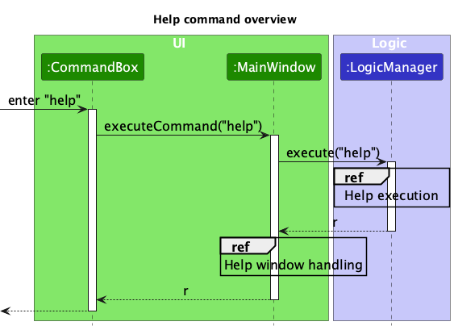
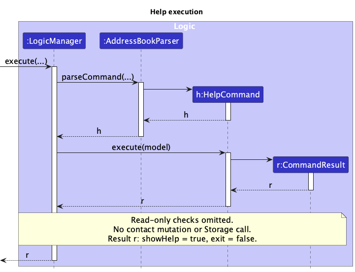
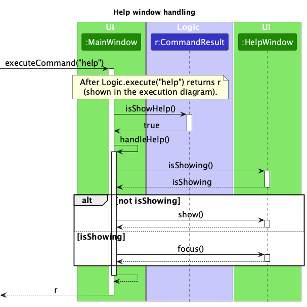

* Table of Contents
{:toc}

--------------------------------------------------------------------------------------------------------------------

## **Acknowledgements**

* TutorContacts is based on the [AddressBook-Level3](https://se-education.org/addressbook-level3/) project created by
  the [SE-EDU initiative](https://se-education.org/), including its code and documentation.
* Third-party libraries used: [JavaFX](https://openjfx.io/), [Jackson](https://github.com/FasterXML/jackson), and
  [JUnit 5](https://github.com/junit-team/junit5).

--------------------------------------------------------------------------------------------------------------------

## **Setting up, getting started**

Refer to the guide [_Setting up and getting started_](SettingUp.md).

--------------------------------------------------------------------------------------------------------------------

## **Design**

:bulb: **Tip:** The `.puml` files used to create diagrams are in `docs/diagrams`. Refer to the [_PlantUML Tutorial_ at se-edu/guides](https://se-education.org/guides/tutorials/plantUml.html) to learn how to create and edit diagrams.

### Architecture

The ***Architecture Diagram*** given above explains the high-level design of the App.

The following provides a quick overview of the main components and their interactions.

**Main components of the architecture**

**`Main`** (consisting of classes [`Main`](https://github.com/se-edu/addressbook-level3/tree/master/src/main/java/seedu/address/Main.java) and [`MainApp`](https://github.com/se-edu/addressbook-level3/tree/master/src/main/java/seedu/address/MainApp.java)) is in charge of the app launch and shut down.
* At app launch, it initializes the other components in the correct sequence, and connects them up with each other.
* At shut down, it shuts down the other components and invokes cleanup methods where necessary.

The bulk of the app's work is done by the following four components:

* [**`UI`**](#ui-component): The UI of the App.
* [**`Logic`**](#logic-component): The command executor.
* [**`Model`**](#model-component): Holds the data of the App in memory.
* [**`Storage`**](#storage-component): Reads data from, and writes data to, the hard disk.

[**`Commons`**](#common-classes) represents a collection of classes used by multiple other components.

**How the architecture components interact with each other**

The *Sequence Diagram* below shows how the components interact with each other for the scenario where the user issues the command `delete 1`.

Each of the four main components (also shown in the diagram above),

* defines its *API* in an `interface` with the same name as the Component.
* provides its functionality through a concrete `{Component Name}Manager` class that implements the corresponding API interface.

For example, the `Logic` component defines its API in `Logic.java` and implements it in `LogicManager.java`. Other components interact with a component through its interface rather than its concrete class, preventing them from coupling to that component's implementation, as illustrated in the following partial class diagram.

The sections below give more details of each component.

### UI component

The **API** of this component is specified in [`Ui.java`](https://github.com/se-edu/addressbook-level3/tree/master/src/main/java/seedu/address/ui/Ui.java)

The UI consists of a `MainWindow` and its parts, such as `CommandBox`, `ResultDisplay`, `PersonListPanel`, and `StatusBarFooter`. All of these, including `MainWindow`, inherit from the abstract `UiPart` class, which captures common behavior among classes that represent visible GUI parts.

The `UI` component uses the JavaFX UI framework. The layouts of these UI parts are defined in matching `.fxml` files in `src/main/resources/view`. For example, [`MainWindow.fxml`](https://github.com/se-edu/addressbook-level3/tree/master/src/main/resources/view/MainWindow.fxml) specifies the layout of [`MainWindow`](https://github.com/se-edu/addressbook-level3/tree/master/src/main/java/seedu/address/ui/MainWindow.java).

The `UI` component,

* executes user commands using the `Logic` component.
* listens for changes to `Model` data so that the UI can be updated with the modified data.
* keeps a reference to the `Logic` component, because the `UI` relies on the `Logic` to execute commands.
* depends on some classes in the `Model` component because it displays `Person` objects from the model.

### Logic component

**API** : [`Logic.java`](https://github.com/se-edu/addressbook-level3/tree/master/src/main/java/seedu/address/logic/Logic.java)

Here's a (partial) class diagram of the `Logic` component:

The sequence diagram below illustrates the interactions within the `Logic` component, taking `execute("delete 1")` API call as an example.

:information_source: **Note:** The lifeline for `DeleteCommandParser` should end at the destroy marker (X), but due to a limitation of PlantUML, it continues to the end of the diagram.

How the `Logic` component works:

1. When `Logic` is called upon to execute a command, the command is passed to an `AddressBookParser` object, which in turn creates a parser that matches the command (e.g., `DeleteCommandParser`) and uses it to parse the command.
1. This results in a `Command` object (more precisely, an object of one of its subclasses e.g., `DeleteCommand`) which is executed by the `LogicManager`.
1. The command can communicate with the `Model` when it is executed (e.g. to delete a person). 
   Note that although this is shown as a single step in the diagram above for simplicity, the code can require several interactions between the command object and the `Model` to complete the operation.
1. The result of the command execution is encapsulated as a `CommandResult` object which is returned from `Logic`.

Here are the other classes in `Logic` (omitted from the class diagram above) that are used for parsing a user command:

How the parsing works:
* When called upon to parse a user command, the `AddressBookParser` class creates an `XYZCommandParser` (`XYZ` is a placeholder for the specific command name, e.g., `AddCommandParser`). The parser uses the other classes shown above to parse the user command and create an `XYZCommand` object (e.g., `AddCommand`). The `AddressBookParser` returns that object as a `Command` object.
* All `XYZCommandParser` classes, such as `AddCommandParser` and `DeleteCommandParser`, implement the `Parser` interface so they can be treated similarly where appropriate, for example during testing.

### Model component
**API** : [`Model.java`](https://github.com/se-edu/addressbook-level3/tree/master/src/main/java/seedu/address/model/Model.java)

The `Model` component,

* stores the address book data i.e., all `Person` objects (which are contained in a `UniquePersonList` object).
* stores the `Person` objects selected by the current filter, such as search results, in a separate _filtered_ list. It exposes this list as an unmodifiable `ObservableList<Person>` that the UI can observe and bind to, so the UI updates when the list changes.
* stores a `UserPrefs` object that represents the user’s preferences (currently, just the GUI settings). This is exposed to the outside as a `ReadOnlyUserPrefs` object.
* does not depend on any of the other three components (as the `Model` represents data entities of the domain, they should make sense on their own without depending on other components)

:information_source: **Note:** The alternative, arguably more object-oriented, design below keeps a unique list of tags in `AddressBook`, and each `Person` references tags from that list. This lets `AddressBook` maintain one `Tag` object per unique tag instead of each `Person` holding its own `Tag` objects. 

### Storage component

**API** : [`Storage.java`](https://github.com/se-edu/addressbook-level3/tree/master/src/main/java/seedu/address/storage/Storage.java)

The `Storage` component,
* can save both address book data and user preference data in JSON format, and read them back into corresponding objects.
* is implemented by `StorageManager`, which delegates the actual JSON file access to `JsonAddressBookStorage` and `JsonUserPrefsStorage` (one class per data file).
* depends on some classes in the `Model` component (because the `Storage` component's job is to save/retrieve objects that belong to the `Model`)

### Common classes

Classes used by multiple components are in the `seedu.address.commons` package.

--------------------------------------------------------------------------------------------------------------------

## **Implementation**

This section describes some noteworthy details on how certain features are implemented.

### Help command and command guide

`HelpCommand` is read-only: it returns a `CommandResult` with `isShowHelp()` set to `true`.
`LogicManager` returns that result without saving contact data. `MainWindow` then calls `handleHelp()`:
it shows its existing `HelpWindow` if closed, or focuses that same window if already open.

The overview below traces a successful typed `help` command. Its `ref` frames expand into the two focused
diagrams that follow, keeping each diagram readable at the guide's normal page width.

**Help execution** (`HelpCommandExecutionSequenceDiagram.puml`). `AddressBookParser` creates the command;
the command creates result `r`. Constructor details and the routine read-only checks are omitted.
The command returns without contact mutation or a Storage call.

**Help window handling** (`HelpWindowSequenceDiagram.puml`). This expands the UI portion of the overview after
`Logic.execute("help")` returns. It shows the `isShowHelp()` check and the mutually exclusive show/focus paths.
The activation of `executeCommand` includes earlier interactions shown separately in the overview and execution
diagram. Result-display updates, logging, and clipboard operations are omitted from all three diagrams.

The Help menu and the F1 accelerator call `MainWindow#handleHelp()` directly, so they share the same
show-or-focus behavior without parsing a command.

`HelpWindow.fxml` contains the command reference. Its scroll pane fits the available width, and command labels
wrap to keep long formats readable. The resizable window starts within the primary screen's visual bounds,
including display scaling. Its User Guide URL and copy button remain outside the scrolling command list.
When a command's syntax changes, update the reference alongside the User Guide.

### \[Proposed\] Undo/redo feature

#### Proposed Implementation

The proposed undo/redo mechanism is facilitated by `VersionedAddressBook`. It extends `AddressBook` with an undo/redo history, stored internally as an `addressBookStateList` and `currentStatePointer`. Additionally, it implements the following operations:

* `VersionedAddressBook#commit()` — Saves the current address book state in its history.
* `VersionedAddressBook#undo()` — Restores the previous address book state from its history.
* `VersionedAddressBook#redo()` — Restores a previously undone address book state from its history.

These operations are exposed in the `Model` interface as `Model#commitAddressBook()`, `Model#undoAddressBook()` and `Model#redoAddressBook()` respectively.

Given below is an example usage scenario and how the undo/redo mechanism behaves at each step.

Step 1. The user launches the application for the first time. The `VersionedAddressBook` will be initialized with the initial address book state, and the `currentStatePointer` pointing to that single address book state.

Step 2. The user executes `delete 5` command to delete the 5th person in the address book. The `delete` command calls `Model#commitAddressBook()`, causing the modified state of the address book after the `delete 5` command executes to be saved in the `addressBookStateList`, and the `currentStatePointer` is shifted to the newly inserted address book state.

Step 3. The user executes `add n/David …​` to add a new person. The `add` command also calls `Model#commitAddressBook()`, causing another modified address book state to be saved into the `addressBookStateList`.

:information_source: **Note:** If a command fails its execution, it will not call `Model#commitAddressBook()`, so the address book state will not be saved into the `addressBookStateList`.

Step 4. The user now decides that adding the person was a mistake, and decides to undo that action by executing the `undo` command. The `undo` command will call `Model#undoAddressBook()`, which will shift the `currentStatePointer` once to the left, pointing it to the previous address book state, and restores the address book to that state.

:information_source: **Note:** If the `currentStatePointer` is at index 0, pointing to the initial AddressBook state, then there are no previous AddressBook states to restore. The `undo` command uses `Model#canUndoAddressBook()` to check if this is the case. If so, it will return an error to the user rather
than attempting to perform the undo.

The following sequence diagram shows how an undo operation goes through the `Logic` component:

:information_source: **Note:** The lifeline for `UndoCommand` should end at the destroy marker (X), but due to a limitation of PlantUML, it continues to the end of the diagram.

Similarly, how an undo operation goes through the `Model` component is shown below:

The `redo` command does the opposite — it calls `Model#redoAddressBook()`, which shifts the `currentStatePointer` once to the right, pointing to the previously undone state, and restores the address book to that state.

:information_source: **Note:** If the `currentStatePointer` is at index `addressBookStateList.size() - 1`, pointing to the latest address book state, then there are no undone AddressBook states to restore. The `redo` command uses `Model#canRedoAddressBook()` to check if this is the case. If so, it will return an error to the user rather than attempting to perform the redo.

Step 5. The user then decides to execute the command `list`. Commands that do not modify the address book, such as `list`, will usually not call `Model#commitAddressBook()`, `Model#undoAddressBook()` or `Model#redoAddressBook()`. Thus, the `addressBookStateList` remains unchanged.

Step 6. The user executes `clear`, which calls `Model#commitAddressBook()`. Since the `currentStatePointer` is not pointing at the end of the `addressBookStateList`, all address book states after the `currentStatePointer` will be purged. Reason: It no longer makes sense to redo the `add n/David …​` command. This is the behavior that most modern desktop applications follow.

The following activity diagram summarizes what happens when a user executes a new command:

#### Design considerations:

**Aspect: How undo & redo execute:**

* **Alternative 1 (current choice):** Saves the entire address book.
  * Pros: Easy to implement.
  * Cons: May have performance issues in terms of memory usage.

* **Alternative 2:** Individual command knows how to undo/redo by
  itself.
  * Pros: Will use less memory (e.g. for `delete`, just save the person being deleted).
  * Cons: We must ensure that the implementation of each individual command is correct.

_{more aspects and alternatives to be added}_

### \[Proposed\] Data archiving

_{Explain here how the data archiving feature will be implemented}_

--------------------------------------------------------------------------------------------------------------------

## **Documentation, logging, testing, dev-ops**

* [Documentation guide](Documentation.md)
* [Testing guide](Testing.md)
* [Logging guide](Logging.md)
* [DevOps guide](DevOps.md)

--------------------------------------------------------------------------------------------------------------------

## **Appendix: Requirements**

### Product scope

**Target user profile**: An independent private tutor who manages approximately 15–30 students and their parents,
works alone, and prefers typing commands to navigating menus. The tutor needs to retrieve contact and tutoring
information while preparing lessons or communicating with parents.

**Value proposition**: TutorContacts keeps student and parent contact information, together with essential tutoring
details, in one place. Typed commands let the tutor record contacts and retrieve the information needed for lesson
preparation or parent communication. The initial MVP focuses on creating, viewing, deleting, and retaining contact
records. Relationship links and other contact-organization features are possible future extensions.

### User stories

Priority describes the importance of a user need, not whether the feature has already been implemented.

Priorities:
* High (must-have for the agreed MVP) - `* * *`;
* Medium (nice-to-have for future versions) - `* *`.

| Priority | As a… | I can… | So that I can… |
| --- | --- | --- | --- |
| `* * *` | private tutor | add a student contact | keep the student's contact information in one place |
| `* * *` | private tutor | add a parent contact | keep the information needed to contact that parent |
| `* * *` | private tutor | record one subject for a student | remember which subject I teach that student |
| `* * *` | private tutor | record a student's academic level | prepare teaching materials appropriate for that student |
| `* * *` | private tutor | add a short note to a contact | remember relevant details such as a lesson preference |
| `* * *` | private tutor | list all my contacts | see my student and parent records at a glance |
| `* * *` | private tutor | view a contact's complete details | read information that is not shown in the contact list |
| `* * *` | private tutor | delete an unwanted contact | remove an incorrect or no longer needed record |
| `* * *` | private tutor | retrieve my contact records after reopening TutorContacts | continue using records entered in an earlier session |
| `* * *` | private tutor | exit TutorContacts safely | end a session without losing an accepted contact change |
| `* *` | private tutor | edit a contact's details | keep the record accurate when details change |
| `* *` | private tutor | find contacts by name | locate someone without scanning the complete list |
| `* *` | private tutor | link a parent to one or more students | identify whom to contact for each student without duplicating the parent's record |
| `* *` | private tutor | archive an inactive contact | keep its information without showing it among active contacts |
| `* *` | new TutorContacts user | see a brief command guide | learn the available commands without reading the full user guide |
| `* *` | private tutor | record multiple subjects for a student | keep all subjects I teach that student in one record |
| `* *` | private tutor | filter students by subject | review contacts relevant to a particular subject |
| `* *` | private tutor | filter students by academic level | review students at a particular level |
| `* *` | private tutor | sort students by academic level | review students at similar levels together |
| `* *` | private tutor | assign custom tags to contacts | group contacts according to my teaching needs |

### Use cases

(For all use cases below, the **System** is `TutorContacts` and the **Actor** is the `user`, unless specified
otherwise. `INDEX` is the one-based position in the displayed contact list. These use cases follow the
[V2 TutorContacts MVP specification](https://docs.google.com/document/d/13atDT_z6unnRSmTLVOimhPvUcavvWek9Xy9jy5YNyFY/edit?tab=t.pgg9f79ckkj4).
Failed commands leave the displayed and saved contact data unchanged. Some specified behavior is not yet implemented
in the current AB3 codebase.)

**Use case: Add a student or parent contact**

**MSS**

1. User enters `add` with a role, name, phone, email, and address. The user supplies a subject and level for a student
   and may supply a note for either role.
2. TutorContacts validates the fields and checks for a duplicate contact.
3. TutorContacts adds the contact to the end of the list and selects its compact card, which shows its index, role,
   name, and phone.
4. TutorContacts saves the updated data file and reports `Added student: NAME.` or `Added parent: NAME.`

   Use case ends.

**Extensions**

* 2a. A general required field is missing, a value is invalid, or a prefix is unknown or repeated.
  * 2a1. TutorContacts shows the applicable format, validation, or prefix error. No contact is added.

    Use case resumes at step 1.
* 2b. A student is missing a subject or level, or a parent has either field.
  * 2b1. TutorContacts shows the role-specific error. No contact is added.

    Use case resumes at step 1.
* 2c. A contact has the same role and normalized name as an existing contact, and its normalized phone or email also
  matches.
  * 2c1. TutorContacts shows `This contact duplicates an existing ROLE: NAME.` No contact is added.

    Use case resumes at step 1.
* 4a. TutorContacts cannot save the data file.
  * 4a1. TutorContacts shows `Contact was not added because TutorContacts could not save the data file.` The contact is
    not added, and the displayed and saved data remain unchanged.

    Use case ends.

**Use case: List all contacts**

**MSS**

1. User enters `list` to see all contacts.
2. TutorContacts shows every contact in insertion order, numbered from 1, with its role, name, and phone on a compact
   card. Any expanded contact card is collapsed.
3. TutorContacts reports `Showing N contacts.`
4. User scans the list. No contact data is changed or saved.

   Use case ends.

**Extensions**

* 1a. User supplies extra text or parameters after `list`.
  * 1a1. TutorContacts shows `Invalid command format. Expected: list` and leaves the displayed list unchanged.

    Use case ends.
* 2a. There are no contacts.
  * 2a1. TutorContacts shows an empty list and reports `No contacts to display.`

    Use case ends.

**Use case: View one contact's complete details**

**MSS**

1. User enters `list` to display contacts.
2. TutorContacts displays contacts with their current index numbers.
3. User enters `view INDEX` for a contact in that displayed list.
4. TutorContacts highlights and expands the indexed contact card in place. The other cards remain compact, and the
   list remains visible.
5. TutorContacts shows the contact's role, name, phone, email, address, note, and subject and level if it is a student.
   TutorContacts reports `Showing contact: NAME.` No contact data is changed or saved.

   Use case ends.

**Extensions**

* 3a. The index is non-numeric, zero, or negative.
  * 3a1. TutorContacts shows `Index must be a positive integer shown in the current list.` The displayed list and
    expanded-card selection remain unchanged.

    Use case resumes at step 3.
* 3b. The index is larger than the currently displayed list.
  * 3b1. TutorContacts shows `No contact exists at index INDEX in the current list.` The displayed list and
    expanded-card selection remain unchanged.

    Use case resumes at step 3.
* 3c. The index is missing, or the user supplies extra arguments.
  * 3c1. TutorContacts shows `Invalid command format. Expected: view INDEX` and leaves the displayed list and
    selection unchanged.

    Use case resumes at step 3.

**Use case: Delete a contact**

**MSS**

1. User enters `list` to display contacts.
2. TutorContacts displays the contacts with their current index numbers.
3. User enters `delete INDEX` for a contact in that displayed list.
4. TutorContacts removes the contact card, refreshes and renumbers the list, and clears the selection if the deleted
   contact was selected.
5. TutorContacts saves the updated data file and reports `Deleted contact: NAME.`

   Use case ends.

**Extensions**

* 3a. The index is non-numeric, zero, or negative.
  * 3a1. TutorContacts shows `Index must be a positive integer shown in the current list.` Nothing is deleted.

    Use case resumes at step 3.
* 3b. The index is larger than the currently displayed list.
  * 3b1. TutorContacts shows `No contact exists at index INDEX in the current list.` Nothing is deleted.

    Use case resumes at step 3.
* 3c. The index is missing, or the user supplies extra arguments.
  * 3c1. TutorContacts shows `Invalid command format. Expected: delete INDEX`. Nothing is deleted.

    Use case resumes at step 3.
* 5a. TutorContacts cannot save the data file.
  * 5a1. TutorContacts shows `Contact was not deleted because TutorContacts could not save the data file.` The contact
    remains, and the displayed and saved data remain unchanged.

    Use case ends.

**Use case: Save data and exit safely**

**MSS**

1. User adds or deletes a contact.
2. TutorContacts saves the contacts and their role-specific fields to `data/tutorcontacts.json` before confirming the
   command.
3. User enters `exit`.
4. TutorContacts reports `Exiting TutorContacts.` and closes after confirming that no accepted change remains unsaved.
5. User launches TutorContacts again.
6. TutorContacts loads every saved contact field and displays the restored compact-card list.

   Use case ends.

**Extensions**

* 2a. TutorContacts cannot save the data file.
  * 2a1. TutorContacts reports the `add` or `delete` save-failure message. The displayed and saved data remain
    unchanged.

    Use case ends.
* 3a. User supplies extra text after `exit`.
  * 3a1. TutorContacts shows `Invalid command format. Expected: exit` and remains open.

    Use case resumes at step 3.
* 6a. The data file is missing.
  * 6a1. TutorContacts starts with an empty list without an error. It creates the file on the first successful
    data-changing command.

    Use case ends.
* 6b. The data file is unreadable or structurally invalid, including an invalid or duplicate contact record.
  * 6b1. TutorContacts starts with an empty list and shows
    `Warning: TutorContacts could not load data/tutorcontacts.json. The existing file was not changed.`
  * 6b2. TutorContacts leaves the existing file unchanged.

    Use case ends.

### Non-Functional Requirements

**Platform and distribution**

1.  Should work on any _mainstream OS_ with Java `25` installed, without requiring any other Java version.
2.  Should run from a single JAR file without an installer.
3.  The JAR file should not exceed 100 MB.

**Performance**

4.  Should hold up to 1000 contacts without noticeable sluggishness for typical usage. This is well above the
    expected 15–30 students and their parents.
5.  Should respond to any command within 2 seconds on a typical laptop when holding up to 1000 contacts.

**Usability**

6.  A user with above-average typing speed for regular English text (i.e. not code, not system admin commands)
    should be able to accomplish most tasks faster using commands than using the mouse.
7.  The GUI should work well (i.e. no resolution-related inconveniences) at screen resolutions of 1920x1080 and
    higher with screen scales of 100% and 125%, and remain usable at resolutions of 1280x720 and higher with a
    screen scale of 150%.

**Data and reliability**

8.  Should store all data locally in a human-editable _data file_, without using a database management system.
9.  Should not lose any change that TutorContacts has confirmed, even if the application is closed immediately
    afterwards.
10. Should leave a data file that it cannot load unchanged at startup, so that the user can inspect or repair it.

**Scope and privacy**

11. Should be used by a single user and should not support shared or multi-user access to the data.
12. Should work without an internet connection and should not depend on any remote server.
13. Should not transmit student or parent contact information outside the user's computer.

### Glossary

* **Academic level**: A student's stage of study, such as `Primary 6`, `Secondary 3`, or `JC 2`. Recorded only for
  student contacts.
* **Compact card**: The summary of a contact shown in the contact list, displaying its index, role, name, and phone.
* **Data file**: The file `data/tutorcontacts.json`, in the same folder as the JAR file, in which TutorContacts saves
  all contacts.
* **Duplicate contact**: A contact with the same role and _normalized name_ as an existing contact, and whose phone
  or email also matches that contact's.
* **Expanded card**: A contact card that shows all of the contact's details after a `view INDEX` command.
* **INDEX**: The one-based position of a contact in the currently displayed contact list.
* **Mainstream OS**: Windows, Linux, Unix, or macOS.
* **MVP**: Minimum viable product; the smallest version of TutorContacts that delivers its core value.
* **Normalized name**: A name after leading and trailing spaces are removed and consecutive internal spaces are
  collapsed into one. Normalized names are compared ignoring case when detecting duplicates, so `Alex  Tan` and
  `alex tan` are the same normalized name.
* **Note**: A short, optional remark on a contact, such as a lesson preference.
* **Parent contact**: A contact with the `parent` role, typically the parent or guardian of a student.
* **Prefix**: A short marker such as `r/` or `n/` that identifies which field a command parameter belongs to.
* **Private tutor**: An independent tutor who works alone, teaching students privately rather than through a school
  or tuition agency.
* **Role**: The type of a contact, either `student` or `parent`, which determines the fields the contact has.
* **Student contact**: A contact with the `student` role, which must also have a subject and an academic level.
* **Subject**: The subject that the tutor teaches a student, such as `A-Math`. Recorded only for student contacts.

--------------------------------------------------------------------------------------------------------------------

## **Appendix: Instructions for manual testing**

### Command parsing and validation

The add parser accepts `r/`, `n/`, `p/`, `e/`, `a/`, `s/`, `l/`, and `o/`. All are single-value prefixes.
Unknown-prefix detection runs before duplicate-prefix detection, followed by base-field presence, role,
role-specific field rules, field-value validation, and model duplicate detection. `Subject`, `Level`, and `Note`
reuse the model/storage foundation; `Person` retains its compatibility constructor for legacy records.
Newly added students must have subject and level, while parents cannot supply either prefix.

Field constructors normalize values and share validation with `ParserUtil` and JSON loading. Names are
compared case-insensitively for duplicate identity; capitalization remains significant for full object equality
and is retained in stored data. `ExitCommandParser` rejects arguments before an exit result can reach the UI.

`MvpCommandIntegrationTest` exercises all five commands, exact feedback, normalized duplicates, preserved
data after rejected input, presentation requests, and JSON round trips. `ParserUtilTest` and field tests cover
limits and invalid values. `ExitCommandParserTest` checks the parameterless exit grammar.

With a disposable data file, manually verify:

1. Add a student with subject, level, a formatted phone, and a note. Run `view 1` and check every stored field.
2. Add a parent without subject or level. Check the parent card omits those fields. An empty `o/` omits its note.
3. Try a student without subject/level, a parent with either prefix, repeated `o/`, an unknown prefix, and a
   field exceeding its length limit. Verify exact errors and unchanged list data, selection, and JSON.
4. Re-add the student's identity with different name/email capitalization or phone separators. Check duplicates
   are rejected. Check a matching name with different phone and email, or a cross-role match, is accepted.
5. Run `list`, `view INDEX`, and `delete INDEX`. Check feedback, insertion order, visible indexes, and selection.
6. Restart and verify all added fields are restored. Check read-only commands do not rewrite the JSON file.
7. Run `exit 3`: the window must remain open. Run `exit`: it should close successfully.

### Contact-card UI

Prefix recognition checks (use disposable test data):

1. Enter `ADD R/PARENT N/Prefix Parent P/81234567 E/prefix@example.com A/311, Clementi Ave 2, #02-25`.
   Check that capitalization is retained and a parent contact is added, then run `view 1` to expand it.
2. Enter `add n/Alex x/foo`. Expect `Unknown prefix: x/.` with the selected contact and expansion unchanged.
3. Enter `add n/Alex N/Bob`. Expect `Prefix n/ may be specified only once.` with no contact-data change.
4. Enter `add r/parent n/Literal Parent p/91234567 e/literal@example.com a/21 Clementi Ave 3 o/Discuss \x/foo`.
   View the added contact and check its note is `Discuss x/foo`. Check the JSON stores that same literal text.

The prefix and student/parent flow tests in `ContactCardsUiTest` check prefix recognition and literal text
through real command-box execution and JSON storage when `RUN_UI_TESTS=true`.

`CommandResult` carries a `ContactListAction` and an optional target contact. `add` requests selection,
`view` requests selection and expansion, and `list` requests collapse. Other successful commands retain the
selection only while that contact remains visible. `MainWindow` applies these requests after `Logic.execute`
returns, including any required save. `PersonListPanel` ignores transient JavaFX selection changes during
execution and reconciles the final list using `ContactListState`, which retains contacts rather than indices.
Failed commands restore the prior presentation against the final model; restoring model data after a failed save
is the logic layer's responsibility.

`ContactListStateTest` runs in the normal headless JUnit suite. `ContactCardsUiTest` additionally checks actual
FXML fields and command-box integration on a desktop. With Java 25, run it using:

* PowerShell: `$env:RUN_UI_TESTS='true'; .\gradlew.bat test --tests '*ContactCardsUiTest' --rerun-tasks`
* macOS/Linux with a graphical display: `RUN_UI_TESTS=true ./gradlew test --tests '*ContactCardsUiTest' --rerun-tasks`

The desktop tests are opt-in because CI does not provide a graphical display on every platform.
They save rendered previews under `build/reports/ui` for visual inspection.

Manual checks for the UI contribution:

1. Start with at least two contacts. Check that compact cards show only index, role, name, and phone.
2. Run `view 2`, then `view 1`: only the latest target should be expanded. Check student subject/level,
   parent omission of those fields, email, address, and note. Check long names and notes wrap without clipping.
3. Run `view 0`, `view 99` (when out of range), and `view 1 extra`: selection and expansion must not change.
4. Run `list`: all cards should be compact. Add a contact: its compact card should be selected and visible.
5. View the second contact and delete the first: the same contact should stay expanded with index 1.
   Delete that selected contact: selection should clear. Repeat within filtered search results.
6. Check resizing and scrolling at 1920x1080 with 100%/125% scaling and 1280x720 with 150% scaling.
   Keyboard command entry must remain usable after selection changes.
7. After the persistence rollback work is integrated, repeat add/delete with a failing save and check both
   the list data and selection remain unchanged. UI tests simulate model restoration; they do not verify storage rollback.

Given below are instructions to test the app manually.

:information_source: **Note:** These instructions only provide a starting point for testers to work on;
testers are expected to do more *exploratory* testing.

### Launch and shutdown

1. Initial launch

   1. Download the JAR file and copy it into an empty folder.

   1. Double-click the JAR file. 
      Expected: The GUI opens with a set of sample contacts. The window size may not be optimal.

1. Saving window preferences

   1. Resize the window to an optimal size. Move the window to a different location. Close the window.

   1. Relaunch the app by double-clicking the JAR file. 
       Expected: The most recent window size and location are retained.

1. _{ more test cases …​ }_

### Deleting a person

1. Deleting a person while all persons are being shown

   1. Prerequisites: List all persons using the `list` command, with multiple persons in the list.

   1. Test case: `delete 1` 
      Expected: The first contact is deleted from the list. The status message shows the deleted contact's details.

   1. Test case: `delete 0` 
      Expected: No person is deleted. The status message shows error details.

   1. Other incorrect delete commands to try: `delete`, `delete x`, `...` (where x is larger than the list size) 
      Expected: Similar to previous.

1. _{ more test cases …​ }_

### Saving data

1. Dealing with missing/corrupted data files

   1. _{Explain how to simulate missing or corrupted data files and state the expected behavior.}_

1. _{ more test cases …​ }_
