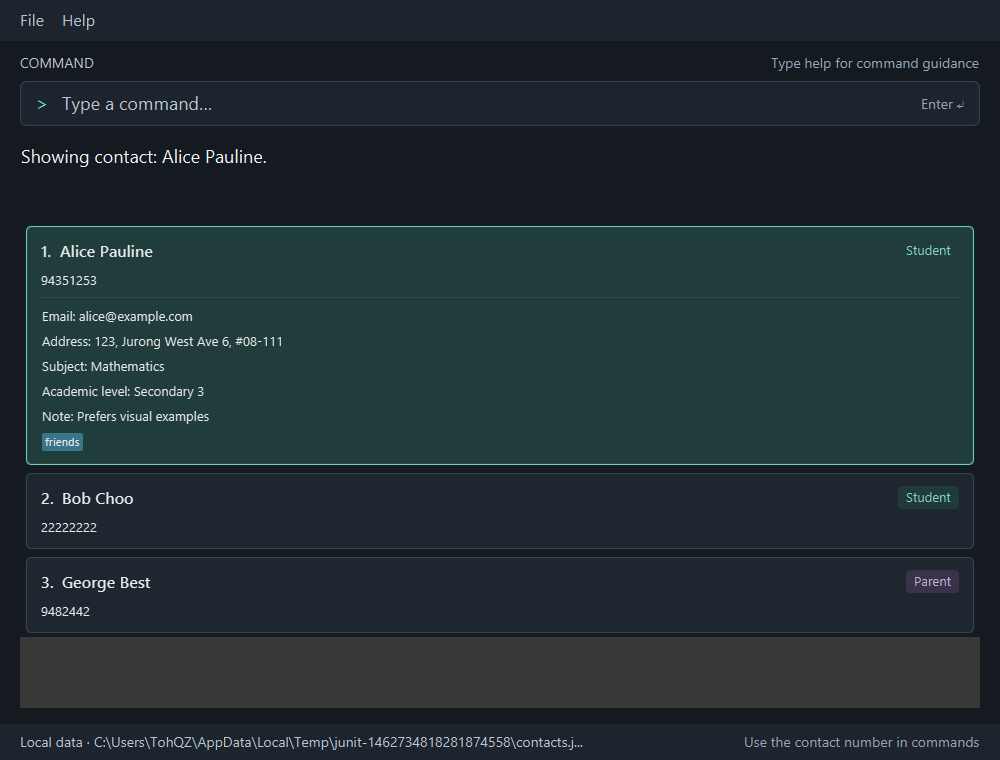
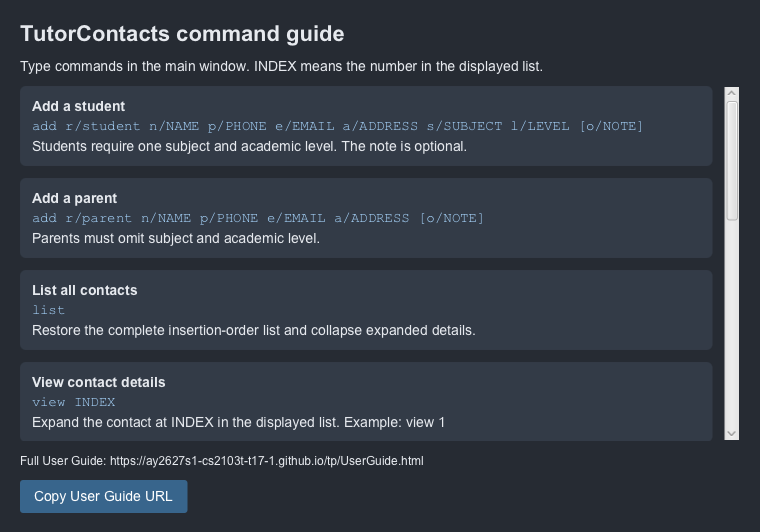
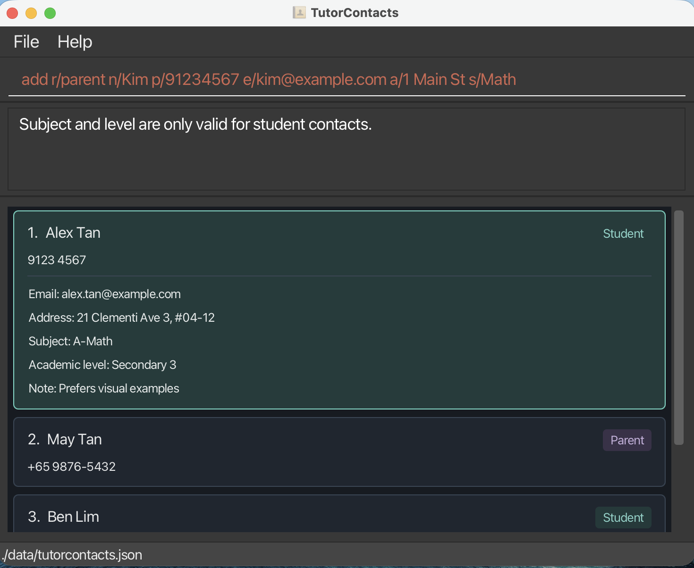
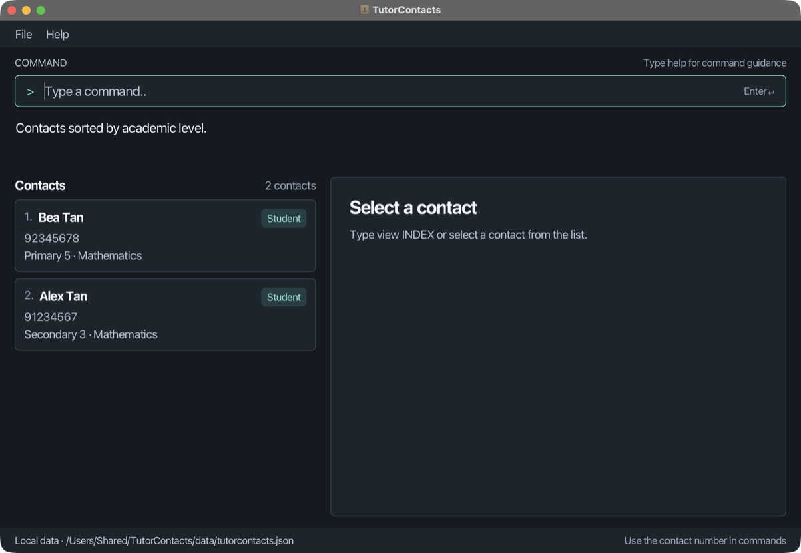
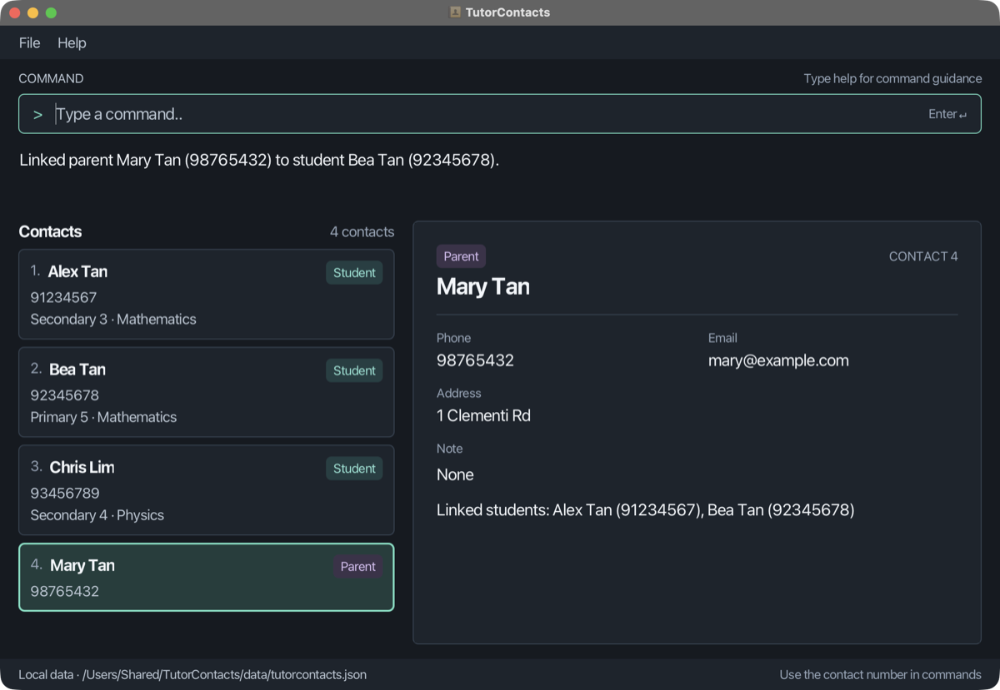
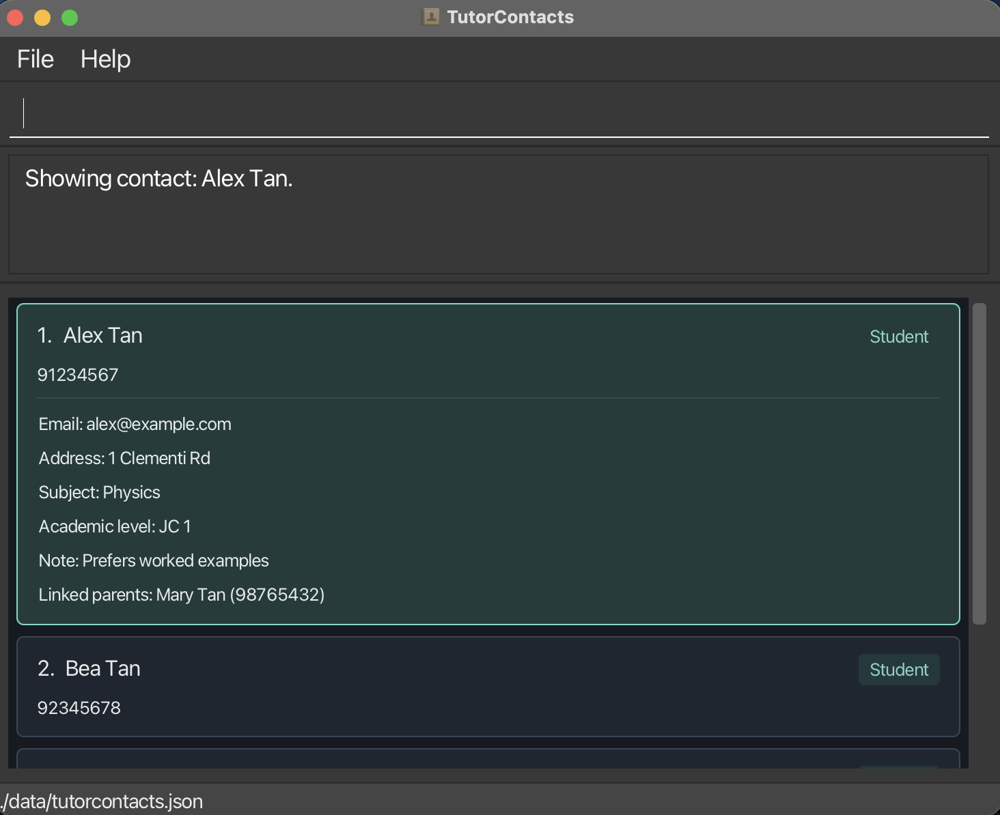
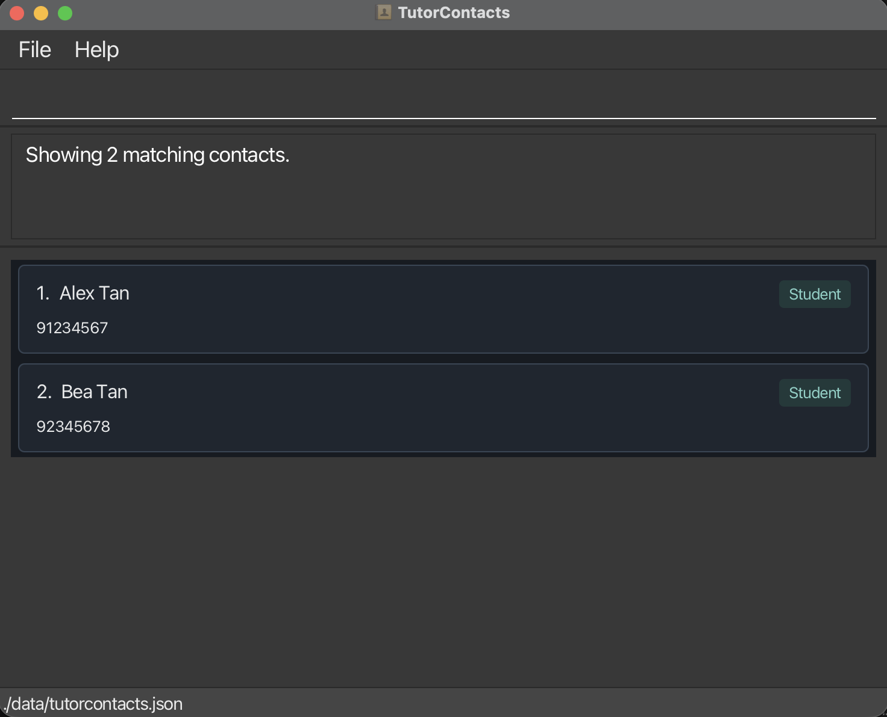

TutorContacts is a **desktop contact manager for independent private tutors, optimized for use through a Command Line
Interface (CLI)** while retaining the benefits of a Graphical User Interface (GUI). It keeps student and parent contact
details, together with each student's subject and academic level, in one place. If you type quickly, TutorContacts can
help you find and manage this information faster than traditional GUI applications.

* Table of Contents
{:toc}

--------------------------------------------------------------------------------------------------------------------

## Quick start

1. Ensure that Java `25` or later is installed on your computer. 
   **Mac users:** Ensure you have the precise JDK version prescribed [here](https://se-education.org/guides/tutorials/javaInstallationMac.html).

1. Download the latest `tutorcontacts.jar` file from [here](https://github.com/AY2627S1-CS2103T-T17-1/tp/releases).

1. Copy the file to the folder you want to use as the _home folder_ for TutorContacts.

1. Open a terminal, `cd` to the folder containing the JAR file, and run `java -jar tutorcontacts.jar`. 
   A GUI similar to the one below should appear in a few seconds. On the first launch, the contact list is empty. 
   

   
:information_source: **If TutorContacts does not start or save as expected:** 
   **Launching:** use `java -jar tutorcontacts.jar` as above. Double-clicking the JAR file may fail, or may use a different Java version. 
   **Saving:** keep the JAR file in a folder you can write to, such as a new folder in your Documents. TutorContacts saves its data in that folder, so a write-protected folder prevents saving. 
   **macOS full screen:** if the main window is in full-screen mode, the Help window may open in a separate space. Exit full-screen mode, or switch spaces, to see it.
   

1. Type a command in the command box and press Enter to execute it. For example, type **`help`** and press Enter to open the help window. 
   Some example commands you can try:

   * `list` : Lists all contacts.

   * `add r/student n/John Doe p/98765432 e/johnd@example.com a/John street, block 123, #01-01 s/Math l/Secondary 3` : Adds a student contact named `John Doe`.

   * `view 1` : Shows the 1st contact in the current list.

   * `delete 1` : Deletes the contact added above (currently the 1st contact in the list).

   * `clear` : Deletes all contacts.

   * `exit` : Exits the app.

1. Refer to the [Features](#features) section below for details of each command.

The command field shows `Type a command…` when empty. The `>` and `Enter ↵` cues are hints, not part of
the command you type. Failed input stays in the field so you can correct it; successful commands clear it.
Feedback appears below the field. Long messages wrap and can be scrolled or selected for copying.
The **Local data** footer shows your contact-data path; hover over the path to see it in full if it is shortened.

--------------------------------------------------------------------------------------------------------------------

## Features

**:information_source: Notes about the command format:** 

* Words in `UPPER_CASE` are the parameters to be supplied by the user. 
  For example, in `add n/NAME`, replace `NAME` with a value such as `John Doe`.

* Items in square brackets are optional. 
  For example, `n/NAME [t/TAG]` can be used as `n/John Doe t/friend` or as `n/John Doe`.

* Items followed by `…`​ can appear zero or more times. 
  For example, `[t/TAG]…​` may be omitted, or written as `t/friend` or `t/friend t/family`.

* Parameters can be in any order. 
  For example, if the command specifies `n/NAME p/PHONE_NUMBER`, `p/PHONE_NUMBER n/NAME` is also acceptable.

* Command words and prefixes are case-insensitive. For example, `list`, `List`, and `LIST` are equivalent,
  and `n/` and `N/` both introduce a name. 
  Parameter values retain their capitalization.

* Extraneous parameters for `help` and `clear` are ignored. 
  For example, `help 123` is interpreted as `help`.

* The `list` and `exit` commands accept no parameters. Additional arguments are rejected.

* Leading and trailing whitespace around the whole command is ignored. This follows Java's whitespace definition,
  including ordinary spaces, tabs, EN SPACE (U+2002), EM SPACE (U+2003), and IDEOGRAPHIC SPACE (U+3000).
  Use ordinary spaces to separate the command word from its parameters and before parameter prefixes.

* If you are using a PDF version of this document, be careful when copying and pasting commands that span multiple lines as space characters surrounding line-breaks may be omitted when copied over to the application.

### Prefixes and literal text

In commands with prefixed parameters (`add` and `edit`), a single ASCII letter followed by `/` at the start
of the arguments or immediately after whitespace starts a parameter. For example, `n/Alex Tan p/91234567`
supplies a name and a phone number. Prefixes ignore case; parameter values retain their capitalization.

An unescaped prefix that the command does not accept is rejected with `Unknown prefix: x/.` The error uses
the lowercase prefix, so `X/` also reports `x/`. Unknown prefixes are checked before the remaining argument
validation. Repeating a single-value prefix, including mixed-case repeats such as `n/Alex N/Bob`, is rejected
with `Prefix n/ may be specified only once.` If several fields repeat, the first field in that command's
validation order is reported. Repeated `t/` values remain supported by `edit`; `add` rejects `t/`.

To include prefix-shaped text literally at the beginning of a value or after whitespace, place a backslash
before it. The backslash is an input escape and is removed from the stored value:

| Input fragment | Result |
| --- | --- |
| `o/Discuss x/foo` | Rejected with `Unknown prefix: x/.` |
| `o/Discuss \x/foo` | Stores the note `Discuss x/foo`. |
| `o/Discuss \n/foo` | Stores the note `Discuss n/foo`; it does not supply another name. |
| `o/\\x/foo` | Stores the note `\x/foo`, retaining one literal backslash. |
| `o/Discussx/foo` | Stores `Discussx/foo`; the slash is within ordinary text. |

Other backslashes are preserved. For example, `o/C:\Tutor\Files` stores the path text as typed.
The escape only controls how parameters are separated; the resulting value must still satisfy its field's
validation rules. It does not enable unsupported parameters.

### Viewing help: `help`

Opens the TutorContacts command guide with command formats, short explanations, and the full User Guide URL.

Format: `help`

* You can also open it using **Help → Help** or **F1** in the main window.
* Scroll through the command reference or resize the Help window to see more of it.
* Select **Copy User Guide URL**, then paste the URL into your browser to read the full guide.
* Running `help` again focuses the existing Help window.
* Opening Help does not change contacts or rewrite the data file.

### Adding a student or parent contact: `add`

Adds a student or parent contact to TutorContacts.

Format: `add r/ROLE n/NAME p/PHONE e/EMAIL a/ADDRESS [s/SUBJECT] [l/LEVEL] [o/NOTE]`

* `ROLE` must be `student` or `parent` and is case-insensitive.
* Role, name, phone, email, and address are required. Parameters may appear in any order.
* Students must supply one subject with `s/` and one academic level with `l/`. Otherwise, TutorContacts reports
  `Student contacts require both s/SUBJECT and l/LEVEL.`
* Parents must omit both `s/` and `l/`; even empty versions of these prefixes are rejected with
  `Subject and level are only valid for student contacts.`

  
* Either role may supply `o/NOTE`. An omitted or whitespace-only note is treated as absent.
* `t/` and other unsupported prefixes are rejected. Adding tags or multiple subjects is not supported.
* On success, TutorContacts reports `Added student: NAME.` or `Added parent: NAME.`
* The newly added contact is selected and scrolled into view; its complete information appears in the detail pane.

Field rules apply to normalized values. Leading and trailing spaces and tabs are trimmed; consecutive spaces in
names, subjects, and levels are collapsed. Capitalization is retained except for roles and academic levels,
which are stored in their canonical forms.

| Field | Accepted values |
| --- | --- |
| Role | `student` or `parent`, ignoring case; stored in lowercase. |
| Name | 1–70 characters; starts with a letter or digit; letters (including accented letters and other scripts' vowel signs and marks), digits, spaces, straight apostrophes (`'`), full stops, and hyphens. Replace a curly apostrophe (`’`) with `'`. Slashes are not allowed, even with a [backslash escape](#prefixes-and-literal-text), so write a patronymic such as `s/o` or `d/o` as `s.o.` or `d.o.`, for example `n/Ravi s.o. Kumar`. |
| Phone | 3–15 digits; optional leading `+`; spaces and hyphens only between digits. |
| Email | One `@`, a nonempty local part, and at least two nonempty dot-separated domain labels. No internal whitespace; domain labels use letters, digits, and internal hyphens. |
| Address | 1–150 characters on one line; no control characters; must include a Unicode letter, number, punctuation mark, or symbol. |
| Subject | 1–40 characters; letters, digits, spaces, and `& + - ' / ( ) . ,`. |
| Level | `Primary 1`–`Primary 6`, `Secondary 1`–`Secondary 5`, or `JC 1`–`JC 2`. Input is case-insensitive and stored as, for example, `Secondary 3` or `JC 2`. |
| Note | 1–200 printable characters on one line, or empty to omit it. |

Addresses retain the existing trimming of leading and trailing characters at or below U+0020, including ordinary spaces
and tabs. The length limit counts Unicode code points, including accompanying combining marks.
Other Unicode spaces, format characters, and combining marks can accompany address content, but cannot
satisfy the required content rule alone. For example, an address containing only ZERO WIDTH SPACE (U+200B),
NON-BREAKING SPACE (U+00A0), or combining accents is rejected. Ordinary Unicode text and its accompanying marks or
formatting are preserved.

This rule uses Unicode categories: BRAILLE PATTERN BLANK (U+2800) counts as a symbol and HANGUL FILLER (U+3164)
counts as a letter, even when they appear blank in a font.

Notes also trim surrounding Java whitespace, including EN SPACE (U+2002), EM SPACE (U+2003), and IDEOGRAPHIC SPACE
(U+3000), before checking the 200-character limit. Internal spacing in a nonblank note is preserved. A note containing
only Java whitespace is absent on add and cleared on edit. NON-BREAKING SPACE (U+00A0) and ZERO WIDTH SPACE (U+200B)
are retained as note content; they do not clear a note.

`JC 5`, `Secondary 6`, `Primary 7`, abbreviations such as `P6`, and custom labels such as `Adult` are
rejected. The error is `Level must be Primary 1-6, Secondary 1-5, or JC 1-2 (for example, Secondary 3).`
The same rules apply to level values in JSON. Unsupported values make the file invalid and trigger
the existing load warning; the file is preserved. Legacy contacts without a level remain supported.

Duplicates require the same role and the same normalized name ignoring case, together with either the same
phone digits (ignoring `+`, spaces, and hyphens) or the same email ignoring case. A matching name alone is
allowed, and students and parents may share contact details. Rejected input leaves contact data unchanged.

Examples:
* `add r/student n/John Doe p/9876 5432 e/johnd@example.com a/John street, block 123, #01-01 s/A-Math l/Secondary 3 o/Prefers visual examples`
* `add r/PARENT n/Betsy Crowe e/betsycrowe@example.com a/311, Clementi Ave 2, #02-25 p/+65 1234-5678 o/Contact after 6 pm`
* `add r/student n/Alex Tan p/91234567 e/alex@example.com a/21 Clementi Ave 3 s/Math l/JC 1 o/Discuss \x/foo`
  stores the note `Discuss x/foo` using the [literal-prefix escape](#prefixes-and-literal-text).

### Listing all contacts: `list`

Displays all contacts in insertion order, numbered from 1. This command clears filtering and sorting
to restore the complete insertion-order list.

Compact cards show index, role, name, and phone, plus academic level and subject for students.
`list` retains the selected contact and its details while restoring the complete insertion-order list.

Format: `list`

* If contacts exist, the result message is `Showing N contacts.`, where `N` is the total number of contacts.
* If no contacts exist, the result message is `No contacts to display.`
* Command words are case-insensitive: `list`, `List`, and `LIST` are accepted.
* Leading and trailing Java whitespace is ignored, including EM SPACE (U+2003). Whitespace alone is not an argument.
* Additional arguments are rejected with `Invalid command format. Expected: list`.
* This command does not change contact details.

Example: `list`

### Sorting contacts by academic level: `sort`

Format: `sort level`

* Students come first: `Primary 1`–`Primary 6`, then `Secondary 1`–`Secondary 5`, then `JC 1`–`JC 2`.
  Names break level ties, ignoring case. Legacy students without levels follow other students;
  parents come last, ordered by name. Equal sort keys have no additional guaranteed order.
* Sorts the current results, retaining the filter and any visible selected contact and its details.
  Sorting remains active as results change; `list` clears filtering and sorting.
* `view`, `edit`, and `delete` use the displayed indices. Sorting does not save data or change stored order.
* `SORT LEVEL` and surrounding Java whitespace are accepted, including EM SPACE (U+2003) around `level`.
  A nonbreaking space (U+00A0) is not Java whitespace and is rejected as part of an unsupported criterion.
  Success: `Contacts sorted by academic level.`,
  including for an empty list. Missing, unsupported, or extra arguments give
  `Invalid command format. Expected: sort level` and leave the display unchanged.

Example: run `find Amy`, then `sort level` to order only the matching contacts. Run `list` to reset.

### Viewing a contact: `view`

Shows the details of the specified contact from TutorContacts.

Format: `view INDEX`

* Views the contact at the specified `INDEX` in the currently displayed list, including search results.
* Supply exactly one **positive integer**: `1`, `2`, `3`, … Use digits only; leading zeros are accepted.
* On success, the message is `Showing contact: NAME.`
* This command does not change contact details or save the data file.
* The selected card is highlighted, and its complete information appears in the separate detail pane.
  All contact cards remain compact. Clicking a card or selecting it with the list's arrow keys also shows its details.
* The detail pane shows email, address, note, linked contacts, and subject and academic level for students.
  An absent note is shown as `None`. Older student records without subject or level show `Not recorded` for those fields.
  Existing tags, if any, appear in the detail pane. Long tags wrap within its width, and all tags can be reached
  by scrolling vertically.
* Use `view` on another contact to change the detail pane. `list` keeps the selected contact and its details.
* On startup, the pane prompts you to select a contact. An empty displayed list shows guidance to use `list` or add a contact.
* The list and detail pane start at a resizable 40/60 split. Below 800 logical pixels of workspace width,
  they stack vertically. Each region scrolls independently. No selection or divider position is saved across restarts.

Examples:
* `list` followed by `view 2` shows the second displayed contact.
* `find Betsy` followed by `view 1` shows the first search result.

Invalid input leaves contact data, the displayed list, and the current selection and displayed details unchanged:

| Input problem | Error message |
| --- | --- |
| Missing or extra arguments | `Invalid command format. Expected: view INDEX` |
| An index that is not a positive integer | `Index must be a positive integer shown in the current list.` |
| An index outside the displayed list | `No contact exists at index INDEX in the current list.` |

### Linking a parent to a student: `link`

Records that a parent contact is the parent of a student contact.

Format: `link PARENT_INDEX STUDENT_INDEX`

* Links the parent at `PARENT_INDEX` to the student at `STUDENT_INDEX`, using the indices in the currently displayed
  list, including search and filter results.
* Supply exactly two **positive integers**. The first must be a parent and the second must be a student.
* A parent can be linked to several students, and a student can be linked to several parents.
* On success, the message is `Linked parent PARENT_NAME (PHONE) to student STUDENT_NAME (PHONE).`
  The parent's card is highlighted and its details appear in the detail pane.
* The detail pane lists linked contacts with their phone numbers, so contacts with the same name can be told apart.
  For example, a parent shows `Linked students: Alex Tan (91234567)` and a student shows `Linked parents: …`.
  A contact without links shows `None`.
* Links are saved with your contacts. Deleting a linked contact removes its links, and editing a linked contact's
  name or phone keeps its links. To remove one link but keep both contacts, use
  [`unlink`](#unlinking-a-parent-from-a-student-unlink).

Examples:
* `list` followed by `link 2 1` links the parent at index 2 to the student at index 1.
* `find Tan` followed by `link 1 3` links the first search result (a parent) to the third (a student).

Invalid input leaves contact data, links, and the displayed list unchanged:

| Input problem | Error message |
| --- | --- |
| Missing or extra arguments | `Invalid command format. Expected: link PARENT_INDEX STUDENT_INDEX` |
| An index that is not a positive integer | `Index must be a positive integer shown in the current list.` |
| An index outside the displayed list | `No contact exists at index INDEX in the current list.` |
| The same existing index twice | `A contact cannot be linked to itself.` |
| The first contact is not a parent | `The contact at index INDEX is not a parent.` |
| The second contact is not a student | `The contact at index INDEX is not a student.` |
| The two contacts are already linked | `PARENT_NAME (PHONE) is already linked to STUDENT_NAME (PHONE).` |

### Unlinking a parent from a student: `unlink`

Removes the link between a parent contact and a student contact. Both contacts are kept.

Format: `unlink PARENT_INDEX STUDENT_INDEX`

* Uses the same indices as `link`: the parent first, then the student, as numbered in the currently displayed list.
* On success, the message is `Unlinked parent PARENT_NAME (PHONE) from student STUDENT_NAME (PHONE).`
  The parent's card is highlighted and its details appear in the detail pane, so you can check its remaining links.
* Only the link between these two contacts is removed. Their other links are kept.

Example:
* `list` followed by `unlink 2 1` removes the link between the parent at index 2 and the student at index 1.

Invalid input leaves contact data, links, and the displayed list unchanged:

| Input problem | Error message |
| --- | --- |
| Missing or extra arguments | `Invalid command format. Expected: unlink PARENT_INDEX STUDENT_INDEX` |
| An index that is not a positive integer | `Index must be a positive integer shown in the current list.` |
| An index outside the displayed list | `No contact exists at index INDEX in the current list.` |
| The same index twice | `A contact cannot be unlinked from itself.` |
| The first contact is not a parent | `The contact at index INDEX is not a parent.` |
| The second contact is not a student | `The contact at index INDEX is not a student.` |
| The two contacts are not linked | `PARENT_NAME (PHONE) is not linked to STUDENT_NAME (PHONE).` |

### Editing a contact: `edit`

Updates a student or parent contact stored by the tutor.

Format: `edit INDEX [n/NAME] [p/PHONE] [e/EMAIL] [a/ADDRESS] [s/SUBJECT] [l/LEVEL] [o/NOTE] [t/TAG]…​`

* `INDEX` is the positive number shown beside the contact in the currently displayed list. At least one field must
  follow it. Prefixes may appear in any order, and fields not supplied remain unchanged.
  An invalid index gets the same messages as `view` and `delete`: `Index must be a positive integer shown in the
  current list.` or `No contact exists at index INDEX in the current list.`
* The tutor may edit `s/SUBJECT` and `l/LEVEL` for a **student contact**. These fields may be changed independently;
  `edit 1 s/Physics` keeps the student's existing level. A parent contact cannot be given either field. This includes
  empty `s/` or `l/` prefixes. `edit` cannot change a contact's role.
* Both student and parent contacts may have a note. `o/NOTE` replaces the note; an empty or whitespace-only `o/`
  **clears** it. Omitting `o/` leaves the note unchanged. Older student records without a subject or level can still
  have other fields edited without filling in the missing fields.
* Subject, level, and note follow the [same field rules as `add`](#adding-a-student-or-parent-contact-add).
  Repeated single-value prefixes and unknown prefixes are rejected as described under
  [Prefixes and literal text](#prefixes-and-literal-text).
* `t/TAG` replaces all existing tags, rather than adding to them. An empty `t/` clears all tags; repeated `t/`
  prefixes can supply multiple replacement tags.
  * A tag contains one or more ASCII letters (`A`-`Z`, `a`-`z`) or digits (`0`-`9`) and no other characters.
  * Tags are case-sensitive. Repeating the exact same tag keeps one copy, while `priority` and `Priority` are
    different tags.
  * TutorContacts does not impose a tag-length or tag-count limit. Long tag names wrap, and large tag collections
    remain within the detail pane's scrollable area.
* Edits still follow the existing duplicate-contact rule: the same role and normalized name, together with a
  matching normalized phone or case-insensitive email, is a duplicate. A duplicate is rejected with
  `This contact duplicates an existing ROLE: NAME (PHONE).`, naming the existing contact.
  Invalid input, a duplicate, or a failed save leaves the displayed and saved contact data unchanged.
  Successful edits are saved automatically.
* After a successful edit, TutorContacts reports the saved details, for example
  `Edited student: Alex Tan (91234567); Email: alex@example.com; Address: 1 Clementi Rd; Subject: Physics;
  Level: JC 1; Note: Prefers worked examples.` Students show their subject and level, and every contact shows its
  note (`None` if empty) and any tags in alphabetical order.
* The complete contact list is then displayed again. A search filter is cleared, so contact indices may change.
  The edited contact becomes selected and its updated details appear in the detail pane at its new index.
  Linked-contact details refresh after the edit.
* Editing a linked contact's name or phone keeps its links to other contacts.

Examples (assuming contact 1 is a student and contact 2 is a parent):

* `edit 1 s/Physics l/JC 1 o/Prefers worked examples` updates a student contact's subject, academic level, and note.
* `edit 1 s/A-Math` changes only a student contact's subject.
* `edit 2 o/Contact after 6 pm` updates a parent contact's note.
* `edit 2 o/` clears an existing note on either role.
* `edit 1 p/91234567 e/johndoe@example.com` updates the first displayed contact's phone and email.
* `edit 2 n/Betsy Crower t/` changes the second displayed contact's name and clears all its tags.

For a parent contact, `edit 2 s/Math` is rejected with `Subject and level are only valid for student contacts.` An
empty `s/` or `l/` is invalid for a student contact rather than a way to remove its subject or level.

### Locating contacts by name: `find`

Finds contacts whose names contain any of the given keywords.

Format: `find KEYWORD [MORE_KEYWORDS]`

* The search is case-insensitive; for example, `hans` matches `Hans`.
* Keyword order does not matter; for example, `Hans Bo` matches `Bo Hans`.
* The search considers only names.
* Only full words match; for example, `Han` does not match `Hans`.
* Contacts matching at least one keyword are returned (an `OR` search); for example, `Hans Bo` returns `Hans Gruber` and `Bo Yang`.
* A new `find` replaces the previous search/filter and retains the current display ordering.

Successful searches report `Showing N matching contacts.`, including `Showing 1 matching contacts.` for one match.
Zero matches (including an empty address book) report `No matching contacts.` and display an empty list.

Examples:
* `find John` returns `john` and `John Doe`
* `find alex david` returns `Alex Yeoh`, `David Li`

### Filtering contacts by name, subject, and level: `filter`

Shows contacts that satisfy **all** supplied criteria.

Format: `filter [n/KEYWORDS] [s/SUBJECT] [l/LEVEL]`

Supply at least one criterion. Square brackets indicate optional criteria and are not typed.
Command words and prefixes are case-insensitive, and prefixes can appear in any order, at most once each.

* **Name:** every keyword must match a complete word in the contact's name, ignoring case. Keyword order does not
  matter. `n/Alice Tan` matches `Alice Tan` and `Tan Alice`, but not `Alice Lim` or `Alicia Tan`.
  Hyphenated names are complete words: `n/Alice` does not match `Alice-Marie`.
* **Subject and level:** match the complete stored value, ignoring case and leading/trailing spaces.
  Repeated spaces are collapsed. `s/Additional Mathematics` does not match `Mathematics`;
  `l/Secondary 3` does not match `Secondary 4`. There are no abbreviations, partial matches, or fuzzy matches.
* **AND only:** every supplied field and every name keyword must match. Use the existing `find` command when you
  want an OR search across name keywords.
* Name-only filtering includes students and parents. Parents and older records without a subject or level cannot
  match a criterion for that missing field. An omitted criterion imposes no restriction on that field.
* Each successful `filter` replaces the previous search/filter across the full contact collection.
* Results default to ascending full-name order, ignoring case. Equal names retain insertion order.
  An already active display ordering is preserved.
* `view INDEX`, `edit INDEX`, and `delete INDEX` use the numbered results currently displayed.
  `list` clears both filtering and ordering, shows all remaining contacts in insertion order, and retains the selected contact's details.
* Selection and details stay with the selected contact if it remains visible; otherwise they clear.
* Filtering does not change stored contacts or rewrite the data file. Filters and display ordering are not retained
  when the application restarts. Startup uses insertion order.
* Existing `add` and `edit` commands clear the filter after success and preserve active display ordering.

Examples:

* `filter n/Alice Tan` shows names containing both complete words.
* `filter s/Mathematics l/Secondary 3` shows Mathematics students at Secondary 3.
* `filter n/Alice s/Mathematics l/Secondary 3` requires all three criteria.
* `filter s/Mathematics`, then `view 1`, shows the first result in the displayed order.
* `filter s/Mathematics`, then `list`, restores the complete insertion-order list.

Successful filtering reports `Showing N matching contacts.`, including `Showing 1 matching contacts.` for one match.
Zero matches (including an empty address book) reports `No matching contacts.` and displays an empty list.

Invalid input leaves contacts, the displayed list, ordering, selection, details, and saved data unchanged.

| Input problem | Error message |
| --- | --- |
| No criteria, or text before the first prefix (such as `filter Alice`) | `Invalid command format. Expected: filter [n/KEYWORDS] [s/SUBJECT] [l/LEVEL]` |
| Unknown prefix such as `x/` | `Unknown prefix: x/.` |
| Repeated prefix such as `n/` and `N/` | `Prefix n/ may be specified only once.` |
| Empty `n/` value | `Name filter requires at least one keyword.` |
| Empty/invalid subject, or over 40 normalized characters | `Subject must be 1-40 characters and use only letters, digits, spaces, or common subject punctuation.` |
| Empty or unsupported academic level | `Level must be Primary 1-6, Secondary 1-5, or JC 1-2 (for example, Secondary 3).` |

Subject values allow letters, digits, spaces, and `& + - ' / ( ) . ,`. Levels use the predefined labels
`Primary 1` to `Primary 6`, `Secondary 1` to `Secondary 5`, and `JC 1` to `JC 2`, ignoring case and repeated spaces.
Tabs inside subject/level values are invalid. Name keywords follow `find`'s
word-splitting rules. Literal prefix-shaped text uses the existing [backslash escape](#prefixes-and-literal-text),
for example `filter s/Topic \x/foo` matches the subject `Topic x/foo`.

When several errors occur, unknown prefixes are checked first, then repeated prefixes (in `n/`, `s/`, `l/` order),
then command structure, then values in `n/`, `s/`, `l/` order.

### Deleting a contact: `delete`

Deletes the specified contact from TutorContacts.

Format: `delete INDEX`

* Deletes the contact at the specified `INDEX` in the currently displayed list, including search results.
* Supply exactly one **positive integer**: `1`, `2`, `3`, … Use digits only; leading zeros are accepted.
* On success, the message is `Deleted contact: ROLE NAME (PHONE).` The role and phone distinguish contacts that
  share a name. The remaining contacts keep their order and are renumbered.
* Deleting a linked contact also removes its links. The message then ends with `Removed COUNT link(s).`
* Deleting the selected contact clears the selection and detail pane. Deleting another contact keeps the selected
  contact highlighted, with its new index and current details.

Examples:
* `list` followed by `delete 2` deletes the second displayed contact.
* `find Betsy` followed by `delete 1` deletes the first search result.

Invalid input leaves contact data and the displayed list unchanged:

| Input problem | Error message |
| --- | --- |
| Missing or extra arguments | `Invalid command format. Expected: delete INDEX` |
| An index that is not a positive integer | `Index must be a positive integer shown in the current list.` |
| An index outside the displayed list | `No contact exists at index INDEX in the current list.` |

### Clearing all contacts: `clear`

Deletes all contacts and links from TutorContacts.

Format: `clear`

### Exiting the program: `exit`

Exits TutorContacts. The feedback message is `Exiting TutorContacts.`

Successful contact changes are saved when you make them, so exiting does not rewrite the data file.
If a change cannot be saved, TutorContacts rejects it and restores the previous contact list; exiting does not retry it.

Format: `exit`

Additional text is rejected with `Invalid command format. Expected: exit`; for example, `exit 3` does not exit.

### Saving the data

TutorContacts automatically saves contact data after commands that change it, such as `add`, `edit`, `link`, `unlink`, `delete`, and
`clear`. You do not need to save manually. Read-only commands such as `list`, `find`, `filter`, `help`, and `exit` do not rewrite
the data file. A failed save leaves both the displayed contacts and the existing data file unchanged.
TutorContacts then says the change was not made, for example
`Contact was not edited because TutorContacts could not save the data file.`

Only one TutorContacts instance can use a JAR folder at a time. A second launch from the same folder shows
`TutorContacts is already running` and exits without reading or writing contacts or preferences. Close the existing
TutorContacts window before launching another instance. Copies in different folders use separate data files and can run
independently.

### Editing the data file

Contact data is saved as a JSON file at `[JAR file location]/data/tutorcontacts.json`. The previous default file,
`data/addressbook.json`, is not loaded automatically; copy it to the new path before starting TutorContacts if you want
to keep those contacts. If the data file is missing, TutorContacts starts with an empty list and creates the file after
the first successful data-changing command. Advanced users can edit the JSON file directly.
Close TutorContacts before editing this file; a running instance does not reload external changes.
The file must contain a single JSON object. A file containing only `null`, or an object followed by another JSON value
or other text, is invalid. Spaces, tabs, and line breaks around the object are allowed.

Launching the JAR from a terminal in another folder still uses the data and preferences beside that JAR.
If an older version saved your contacts under a different launch folder, close TutorContacts and copy that folder's
`data/tutorcontacts.json` into the JAR folder's `data` directory. Back up both copies before replacing an existing file.

Links are saved in a `links` list. Each link names the parent and student by their name and phone, for example
`{ "parentName": "Bernice Yu", "parentPhone": "99272758", "studentName": "Alex Yeoh", "studentPhone": "87438807" }`.
If you change a contact's name or phone in the file, update its links too: a link to a contact that does not exist
makes the file invalid.

The address content rule also applies to JSON. An older file containing an address made only of spaces, format
characters, or combining marks is invalid under this rule. TutorContacts displays the load warning below and preserves
the entire file. Back up the file, replace the invalid address with valid address text, and restart to load the contacts.

A missing, empty, or Java-whitespace-only stored note is loaded as absent. Surrounding Java whitespace is removed
from a nonblank note. Loading does not rewrite the contact file; the normalized values are saved with the next
successful contact change.

:exclamation: **Caution:**
If the data file is invalid or unreadable, TutorContacts starts with an empty list and displays
`Warning: TutorContacts could not load data/tutorcontacts.json. The existing file was not changed.`
TutorContacts will not overwrite that file during the session; repair it and restart the app before changing contacts.
Until then, commands that change contacts reply `Changes are disabled because TutorContacts could not load
data/tutorcontacts.json. Repair the file, then restart TutorContacts.`
Back up the file before editing it. 
Certain edits can also cause TutorContacts to behave unexpectedly (for example, if a value is outside the acceptable
range). Edit the data file only if you are confident that you can update it correctly.

Window settings are stored separately in `preferences.json` next to the JAR file. You can also copy this file from an
older launch folder while the app is closed if you want to retain its window settings.
If the file is invalid or unreadable,
TutorContacts uses default window settings and displays
`Warning: TutorContacts could not load preferences.json. Default window settings are in use; the existing file was not changed.`
The file is not overwritten at startup or exit. Repair or rename it before restarting if you want window settings to be
saved again. Contact data is unaffected. If both files cannot be loaded, both warnings appear.

--------------------------------------------------------------------------------------------------------------------

## FAQ

**Q**: How do I transfer my data to another computer? 
**A**: Install the app on the other computer and overwrite the data file it creates with the data file from your previous TutorContacts home folder.

--------------------------------------------------------------------------------------------------------------------

## Known issues

1. **When using multiple screens**, if you move the application to a secondary screen, and later switch to using only the primary screen, the GUI will open off-screen. The remedy is to delete the `preferences.json` file created by the application before running the application again.
2. **If you minimize the Help Window** and then run the `help` command (or use the `Help` menu, or the keyboard shortcut `F1`) again, the original Help Window will remain minimized, and no new Help Window will appear. The remedy is to manually restore the minimized Help Window.

--------------------------------------------------------------------------------------------------------------------

## Command summary

Action | Format, Examples
--------|------------------
**Add** | `add r/ROLE n/NAME p/PHONE e/EMAIL a/ADDRESS [s/SUBJECT] [l/LEVEL] [o/NOTE]`   e.g., `add r/student n/James Ho p/22224444 e/jamesho@example.com a/123, Clementi Rd, 1234665 s/Math l/Secondary 3`
**Clear** | `clear`
**Delete** | `delete INDEX`  e.g., `delete 3`
**Edit** | `edit INDEX [n/NAME] [p/PHONE] [e/EMAIL] [a/ADDRESS] [s/SUBJECT] [l/LEVEL] [o/NOTE] [t/TAG]…​`  e.g., `edit 1 s/Physics l/JC 1 o/Prefers examples`
**Find** | `find KEYWORD [MORE_KEYWORDS]`  e.g., `find James Jake`
**Filter** | `filter [n/KEYWORDS] [s/SUBJECT] [l/LEVEL]` (at least one criterion)  e.g., `filter s/Mathematics l/Secondary 3`
**Link** | `link PARENT_INDEX STUDENT_INDEX`  e.g., `link 2 1`
**Unlink** | `unlink PARENT_INDEX STUDENT_INDEX`  e.g., `unlink 2 1`
**List** | `list`
**Sort** | `sort level`
**View** | `view INDEX`  e.g., `view 2`
**Help** | `help`
**Exit** | `exit`
